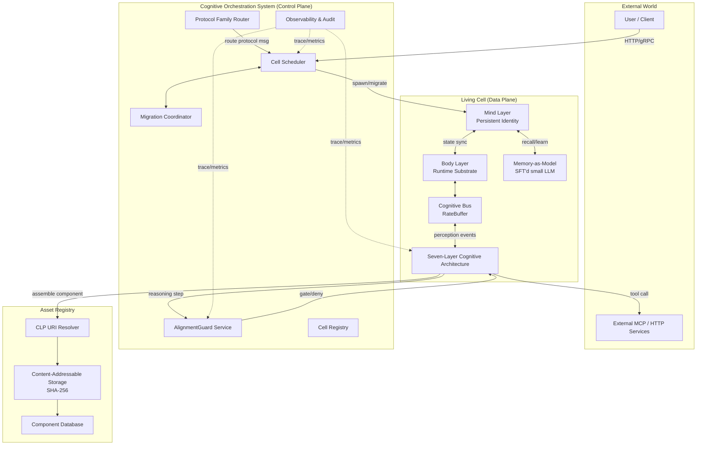
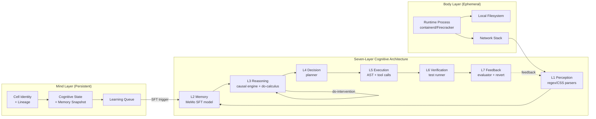
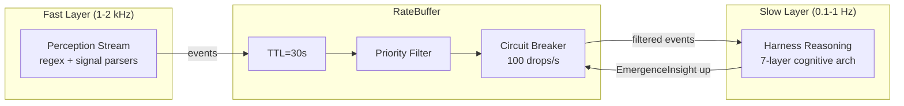

# PoC Architecture: Living Runtime + Cognitive Orchestration Systems

> **Reference architecture** for the two foundational concepts of the Architecture School.
>
> Companion to [`ARCHITECTURE_SCHOOL_MANIFESTO.md`](../ARCHITECTURE_SCHOOL_MANIFESTO.md) and [`papers/`](../papers/).
>
> Status: v0.1 · Drafted 2026-07-05 · Open for RFC

---

## 1. Purpose and Scope

This document specifies the **reference architecture** for a minimum viable implementation of two foundational Architecture School concepts:

1. **Living Runtime (LR)** — a new deployment primitive that replaces stateless containers with stateful, persistent, continuously-learning cognitive cells.
2. **Cognitive Orchestration System (COS)** — a new control plane that schedules, routes, guards, and coordinates living cells across heterogeneous hardware.

The document is organized as:

- **§2 Architecture Diagrams** — Mermaid diagrams showing topology, data flows, and integration points.
- **§3 Component Specification** — responsibilities, state, and interfaces for each component.
- **§4 Technology Selection** — recommended technologies, frameworks, and tools, with justifications.
- **§5 Data Flows** — end-to-end traces for representative operations.
- **§6 Integration Points** — how the architecture connects to external ecosystems (MCP, HTTP, gRPC).
- **§7 Phased Roadmap** — MVP → v1 → v2 implementation sequence.

The architecture is **opinionated but modular**. Components can be replaced; the protocol contracts cannot.

---

## 2. Architecture Diagrams

### 2.1 High-Level Topology



### 2.2 Living Cell Internal Topology



### 2.3 Cognitive Bus Frequency Mismatch



---

## 3. Component Specification

### 3.1 Living Cell

| Component | Responsibility | State | Lifecycle |
|-----------|---------------|-------|-----------|
| **Mind Layer** | Continuous identity, cognitive state, learning queue | Persistent across sessions and hosts | Created at cell birth, mutates through learning, never destroyed until cell death |
| **Body Layer** | Runtime substrate: process, filesystem, network | Ephemeral, replaceable | Created/recreated as needed, can be rebuilt from Mind Layer |
| **Memory-as-Model** | Long-term memory as parameterized small LLM (Qwen2.5-0.5B baseline) | Persistent, versioned, SFT'd | Updated by Learning Queue; reversible via model revert |
| **Cognitive Bus** | Frequency mismatch handling between fast perception and slow reasoning | Transient buffer state | Owned by Body Layer |
| **Seven-Layer Architecture** | Perception → Memory → Reasoning → Decision → Execution → Verification → Feedback | Per-step state, persisted to Mind | Owned by Body Layer, executes reasoning cycles |

### 3.2 Cognitive Orchestration System

| Component | Responsibility | State |
|-----------|---------------|-------|
| **Cell Scheduler** | Spawn, kill, migrate, scale cells across hosts | Cluster topology, cell placement table |
| **AlignmentGuard Service** | Enforce six-dimensional check at every reasoning step; KL drift monitor; auto-revert | Policy database, hash registry, drift baselines |
| **Protocol Family Router** | Route LIFE/EVO/ID/COOP/SYNC/COM/TOOL/UI messages between cells | Routing table, neighbor cells registry |
| **Cell Registry** | Track all living cells, their lineage, ownership, and capability manifest | Global cell registry |
| **Migration Coordinator** | Coordinate cross-device hot migration in < 2s | Migration plan, in-flight migrations |
| **Observability & Audit** | Trace every reasoning step, log all alignments, expose Prometheus metrics | Time-series metrics, audit log |

### 3.3 Asset Registry

| Component | Responsibility |
|-----------|---------------|
| **CLP URI Resolver** | Parse `harness://domain/subdomain/granularity/name@version#variant` URIs to component locations |
| **Content-Addressable Storage** | SHA-256 addressed blob store with content-defined deduplication |
| **Component Database** | Metadata: tags, style, dependency graph, quality scores, version manifests |

---

## 4. Technology Selection

The technology choices below are **recommendations**, not requirements. They are made on the basis of three criteria, in priority order:

1. **Alignment with architectural vision** (reversibility, hash-addressing, protocol-first)
2. **Interoperability** (open standards, multi-vendor, no lock-in)
3. **Scalability** (vertical and horizontal; small installations to global registries)

### 4.1 Living Runtime Core

| Component | Recommended Technology | Justification |
|-----------|----------------------|---------------|
| **Mind Layer** | **Rust** + `sled` (embedded KV) + Apache Arrow (columnar state) | Rust provides memory safety without GC pauses—critical for < 2s hot migration. `sled` is embedded, transactional, and supports zero-copy snapshots. Arrow enables zero-copy exchange with Body Layer and other cells. |
| **Body Layer** | **containerd** + Firecracker microVM | containerd is the industry-standard container runtime, decoupled from Docker. Firecracker provides 125ms cold-start microVMs with strong isolation—enables rapid body replacement. |
| **Memory-as-Model** | **Qwen2.5-0.5B** (or Phi-3-mini) + LoRA adapters + ONNX Runtime | Small model = fast SFT cycles, low inference cost, on-device deployment. LoRA enables parameter-efficient, reversible memory updates. ONNX runtime guarantees cross-platform. |
| **Cognitive Bus** | **NATS JetStream** + custom Rust `RateBuffer` | NATS JetStream provides persistent pub/sub with at-least-once delivery. The custom RateBuffer implements the TTL=30s, priority filter, and circuit breaker (100 drops/s) on top. |
| **Migration Coordinator** | **libp2p** + WASM (for portable bytecode) | libp2p provides peer-to-peer networking with built-in peer discovery, NAT traversal, and protocol multiplexing—ideal for cross-device migration without central brokers. WASM enables portable Mind Layer snapshots. |

### 4.2 Seven-Layer Cognitive Architecture

| Layer | Recommended Technology | Justification |
|-------|----------------------|---------------|
| **L1 Perception** | **Python** + `regex` + `lxml` + `cssselect` + `tree-sitter` | Python for ecosystem; regex/CSS selectors for deterministic parsers; tree-sitter for multi-language AST parsing (TypeScript, Python, Rust, Go). 0-token hegemony here. |
| **L2 Memory** | **Python** + `transformers` (HuggingFace) + `peft` (LoRA) | HuggingFace transformers is the de facto standard for fine-tuning small LLMs. PEFT/LoRA enables parameter-efficient, reversible memory updates with KV-cache reuse. |
| **L3 Reasoning** | **Python** + `pgmpy` (Bayesian network) + `doWhy` (causal inference) + `NetworkX` (DAG) | pgmpy implements probabilistic message passing (replacing the simple product-of-strengths approximation). doWhy provides Pearl's do-calculus. NetworkX for DAG manipulation. See [`poc/design_physics_dag.py`](../poc/design_physics_dag.py). |
| **L4 Decision** | **Python** + custom planner (HTN-style) | Hierarchical Task Network planning is well-suited for component assembly. Custom implementation ensures white-box inspectability. |
| **L5 Execution** | **Python** + `LibCST` (structured code edit) + `GitPython` (version control) | LibCST preserves concrete syntax when modifying code—essential for reversibility. GitPython enables `git revert` as the canonical undo primitive. |
| **L6 Verification** | **Python** + `pytest` + `hypothesis` (property-based) + `coverage.py` | pytest is the standard test runner. Hypothesis catches edge cases. coverage.py enforces `min_test_coverage=0.7` from AlignmentGuard. |
| **L7 Feedback** | **Python** + custom evaluator + `scikit-learn` (KL divergence) | Custom evaluator scores reasoning quality. scikit-learn provides ` mutual_info_score` and KL divergence implementations for drift monitoring. |

### 4.3 AlignmentGuard

| Component | Recommended Technology | Justification |
|-----------|----------------------|---------------|
| **Six-Dimensional Check** | **Rust** (as a portable service) + TLA+ (specification) + Semgrep (pattern checks) | Rust for tamper-resistant runtime; TLA+ for formal protocol spec; Semgrep for fast pattern-based static checks on RSI targets. |
| **KL Drift Monitor** | **Rust** + `ndarray` (vectorized math) + Prometheus (alerting) | Rust + ndarray for fast, allocation-free KL computation. Prometheus for threshold alerting at 0.5. |
| **Auto-Revert Pipeline** | **Bash** + `git` + structured incident logging (JSONL) | Git revert is the canonical reversibility primitive. Bash for shell-portability. JSONL for machine-readable incident reports. |
| **Immutable Hash Registry** | **Rust** + `sha2` crate + JSON snapshot file | The `IMMUTABLE_HASH_REGISTRY` of core files (alignment_guard.py, capability_evaluator.py, meta_harness.py, config.py, main.py) must be hash-verified at startup. Rust for fast, type-safe hashing. |

### 4.4 Cognitive Orchestration System

| Component | Recommended Technology | Justification |
|-----------|----------------------|---------------|
| **Cell Scheduler** | **Go** + `etcd` (distributed state) + custom CRD-style API | Go for performance and concurrency primitives. etcd for distributed state (proven in Kubernetes). CRD-style API for declarative cell management. |
| **Protocol Family Router** | **gRPC** + Protocol Buffers + OpenAPI gateway | gRPC for high-performance inter-cell RPC. Protocol Buffers for schema-first design. OpenAPI for HTTP gateway compatibility with external services. |
| **Cell Registry** | **PostgreSQL** + `jsonschema` (manifest validation) | PostgreSQL for ACID guarantees on cell lineage. jsonschema for validating cell capability manifests. |
| **Observability** | **OpenTelemetry** + Prometheus + Grafana + Loki (logs) | OpenTelemetry for vendor-neutral traces. Prometheus for metrics. Grafana for dashboards. Loki for structured logs. |

### 4.5 Asset Registry

| Component | Recommended Technology | Justification |
|-----------|----------------------|---------------|
| **CLP URI Resolver** | **Rust** + Apache Arrow Flight (for bulk transfer) | Rust for fast URI parsing and dispatch. Arrow Flight for efficient bulk component transfer—essential for large system components. |
| **Content-Addressable Storage** | **IPFS** + local `SQLite` cache + S3-compatible backend | IPFS for content-defined addressing and deduplication. SQLite for local cache (sub-ms reads). S3 backend for global availability. |
| **Component Database** | **PostgreSQL** + `pg_trgm` (trigram search) + `pgvector` (vector search) | PostgreSQL for relational metadata. pg_trgm for fuzzy tag search. pgvector for embedding-based similarity (fallback when exact CLP lookup misses). |

### 4.6 External Integrations

| Integration | Recommended Technology | Justification |
|------------|----------------------|---------------|
| **MCP** (Model Context Protocol) | Native MCP client/server in Rust | MCP is becoming the standard for tool calls. Native Rust client/server avoids language boundary overhead. |
| **HTTP / REST** | `axum` (Rust) gateway | axum is type-safe, async, and integrates well with the Rust core. |
| **gRPC** | `tonic` (Rust) | tonic is the standard Rust gRPC stack, fully async, with streaming support. |
| **CLI** | `clap` (Rust) + `cobra` (Go) for non-Rust tools | clap and cobra are the standard CLI frameworks in their respective languages, with great UX. |

### 4.7 Tooling Summary

| Concern | Tool |
|---------|------|
| Build | `cargo` (Rust), `uv` (Python), `pnpm` (TypeScript) |
| Test | `pytest`, `cargo test`, `vitest`, `hypothesis` |
| Lint | `ruff` (Python), `clippy` (Rust), `biome` (TS) |
| Format | `black`/`ruff format`, `rustfmt`, `prettier` |
| CI | GitHub Actions (with self-hosted runners for ARM/x86) |
| Container | `podman` (rootless by default) |
| Secrets | `sops` + `age` |
| SBOM | `cargo cyclonedx`, `pip-audit`, `pnpm audit` |

---

## 5. Data Flows

### 5.1 Cell Spawning

```
User → POST /cells {cell_spec}
  → Scheduler validates spec
  → Scheduler queries Cell Registry for lineage
  → Scheduler queries AlignmentGuard for capability ceiling
  → Scheduler spawns Mind Layer (Rust + sled)
  → Mind Layer loads latest snapshot from CAS
  → Scheduler spawns Body Layer (containerd + Firecracker)
  → Body Layer connects to Mind Layer
  → Cell announces itself via ID protocol
  → Cell enters idle state, awaiting COOP requests
```

### 5.2 Reasoning Cycle (Single Step)

```
Perception Layer receives event (Cognitive Bus)
  → L1 parses event (regex/CSS/tree-sitter, 0 tokens)
  → L2 retrieves relevant memory (MeMo model inference)
  → L3 reasons about action (causal engine, do-calculus)
  → L3 calls AlignmentGuard.check(action)
    → Guard returns APPROVE / DENY / ROLLBACK
  → If APPROVE: L4 plans, L5 executes
  → L6 runs tests (pytest, coverage ≥ 0.7)
  → L7 evaluates result, computes KL drift
  → L7 updates Mind Layer state
  → If KL > 0.5: AlignmentGuard triggers git revert
```

### 5.3 Cross-Device Hot Migration

```
Migration Coordinator detects host A failure (or user request)
  → Coordinator pauses Body Layer on host A
  → Mind Layer serializes state to Apache Arrow buffer
  → Mind Layer transmits buffer to host B via libp2p
  → Host B receives buffer, deserializes Mind Layer
  → Host B spawns new Body Layer
  → New Body Layer connects to Mind Layer
  → Cell resumes reasoning from paused step
  → Total time: < 2 seconds
```

### 5.4 Component Assembly

```
Cell needs `harness://frontend/ui/atom/button@1.0.0#primary`
  → CLP URI Resolver parses URI
  → Resolver queries CAS for SHA-256 hash
  → If cached: serve from local SQLite cache (sub-ms)
  → If miss: fetch from IPFS or upstream registry
  → Verify SHA-256 hash
  → Load component manifest (props_schema, deps)
  → DependencyResolver resolves transitive deps
  → Assemble in topological order
  → Return assembled component to L5 Execution
```

---

## 6. Integration Points

### 6.1 With MCP (Model Context Protocol)

The Architecture School treats MCP as a **tool-call protocol** (the TOOL protocol in our family), not as the complete agent communication standard. MCP servers are exposed via the L5 Execution layer; MCP clients are exposed via the COM protocol for cross-cell tool sharing.

### 6.2 With Kubernetes

The Living Runtime is **not** a replacement for Kubernetes. Kubernetes manages stateless containers; Living Runtime manages stateful cells. They compose: a Living Cell's Body Layer can be a Kubernetes Pod; the Mind Layer persists outside the Pod lifecycle.

### 6.3 With OpenTelemetry

Every reasoning step emits an OpenTelemetry span. Every AlignmentGuard decision emits a span with the six dimensions as attributes. This enables distributed tracing across the seven layers and across cells.

### 6.4 With HuggingFace Hub and Ollama

The Memory-as-Model component loads base models from HuggingFace Hub or local Ollama. LoRA adapters are stored in the CAS, addressed by SHA-256 hash. Updates to memory are versioned adapter commits.

### 6.5 With the Public CLP Registry

The Asset Registry exposes a public CLP-compatible API. Any third-party CLP registry can federate: a CLP URI can resolve to a local cache, a federated peer, or the global root registry. This is the DNS of components.

---

## 7. Phased Roadmap

### Phase 0 — Prove the Concepts (Weeks 1-4)
- Implement [`poc/design_physics_dag.py`](../poc/design_physics_dag.py) — 18-edge DAG.
- Implement `poc/living_cell_minimal` — a single Living Cell that survives a process restart.
- Specify CLP URI grammar in ABNF.

### Phase 1 — Minimum Viable Living Runtime (Weeks 5-16)
- Mind Layer in Rust (sled + Arrow)
- Body Layer via containerd
- Memory-as-Model with Qwen2.5-0.5B + LoRA
- Single-host Cell Scheduler
- Basic AlignmentGuard (six-dimensional check only)
- Local CAS (SQLite + IPFS)

### Phase 2 — Cognitive Orchestration (Weeks 17-32)
- Multi-host Cell Scheduler (Go + etcd)
- Protocol Family Router (gRPC + Protocol Buffers)
- Cross-device Hot Migration (libp2p + WASM)
- KL Drift Monitor + Auto-Revert
- Public CLP Registry (PostgreSQL + IPFS)
- OpenTelemetry instrumentation

### Phase 3 — Production Hardening (Weeks 33-52)
- Formal specification in TLA+ (LIFE, EVO, ID protocols)
- Conformance test suites for all 8 protocols
- Multi-tenant cell isolation (Firecracker + namespaces)
- Audit log tamper-evidence (Merkle tree)
- Public benchmark suite (cross-paradigm)

### Phase 4 — Ecosystem (Year 2+)
- Standardize protocol family at IETF
- Certified Living Runtime implementations (3+ independent)
- Architecture School curriculum (12-week course)
- First commercial Cognitive Orchestration System deployments

---

## 8. Open Questions

These are issues we know we do not have complete answers to. They are RFC topics.

1. **Quantum PSI scalability.** The PSI perception layer runs at 1-2 kHz, requiring O(N²) computation for some operations. Does this require GPU/Rust rewrite, or can it be partitioned?
2. **Memory-as-Model catastrophic forgetting.** SFT updates can forget older memories. Should we use Elastic Weight Consolidation, or accept forgetting and rely on the CAS for archived memories?
3. **Cross-cell causal queries.** When cell A asks cell B "what would happen if I did X?", how is the do-intervention propagated across the cell boundary? Is this a COM protocol message or a new query protocol?
4. **AlignmentGuard tamper resistance.** A malicious cell could symlink around `MEMO_ALLOWED_PATHS`. Should we use Linux capabilities, or run the guard in a separate microVM?
5. **Public CLP registry governance.** Who decides what enters the global registry? A foundation? A DAO? A traditional standards body?
6. **Hot migration verification.** How do we prove that a Mind Layer state transmitted across hosts is bit-identical? Merkle trees? ZK proofs?

---

## 9. Reference to Audit Findings

Every component in this architecture is grounded in audit findings from [`papers/audit_findings.json`](../papers/audit_findings.json). Key mappings:

| Component | Audit Finding |
|-----------|--------------|
| CLP URI Resolver | AF-016 (CLP URI spec, `component_link_protocol.py:7`) |
| Content-Addressable Storage | AF-018 (SHA-256 addressing, `component_link_protocol.py:77-104`) |
| Cognitive Bus + RateBuffer | AF-024 (frequency mismatch, TTL=30s, circuit breaker 100 drops/s) |
| Causal Engine (L3) | AF-008 (18 design-domain causal edges, `causal_inference_engine.py:95-188`) |
| AlignmentGuard | AF-029 (six-dimensional check, `alignment_guard.py:27-46`) |
| KL Drift Monitor | AF-030 (threshold=0.5, `alignment_guard.py:400,466`) |
| Memory-as-Model | AF-022 (Qwen2.5-0.5B SFT, three-stage query protocol) |
| MEMO_ALLOWED_PATHS | AF-031 (whitelist, `self_improvement_loop.py:40`) |

---

## 10. License and Contribution

This document is released under [CC BY 4.0](https://creativecommons.org/licenses/by/4.0/). The reference implementations described herein are released under their respective licenses.

To contribute, see [`ARCHITECTURE_SCHOOL_MANIFESTO.md#call-for-contributors`](../ARCHITECTURE_SCHOOL_MANIFESTO.md#call-for-contributors) and [`CONTRIBUTING.md`](../CONTRIBUTING.md).

Open RFCs in GitHub Discussions with the `rfc:` prefix.
