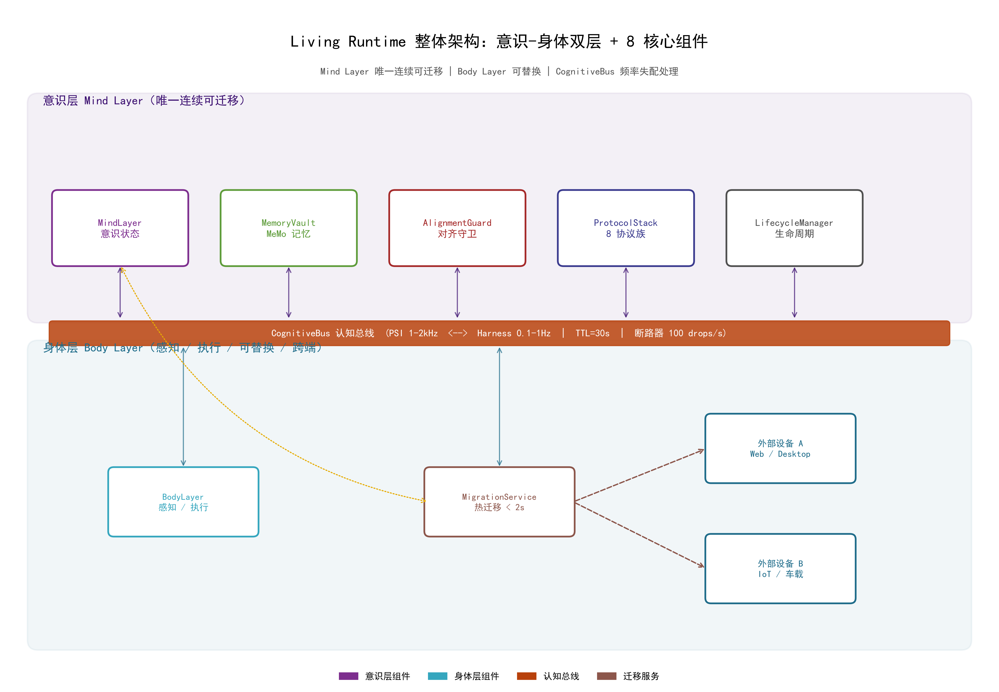
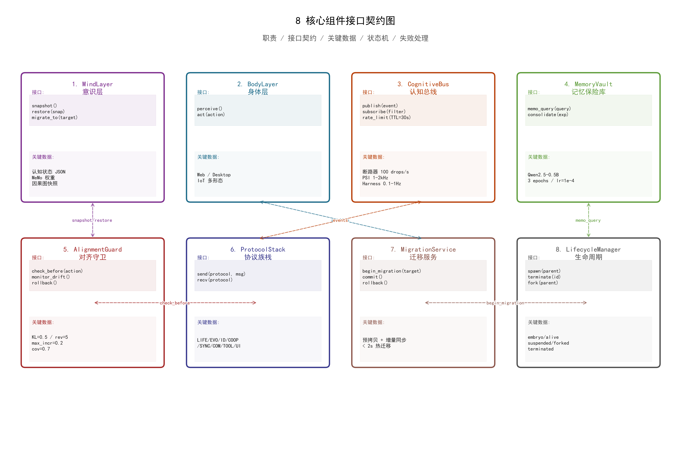
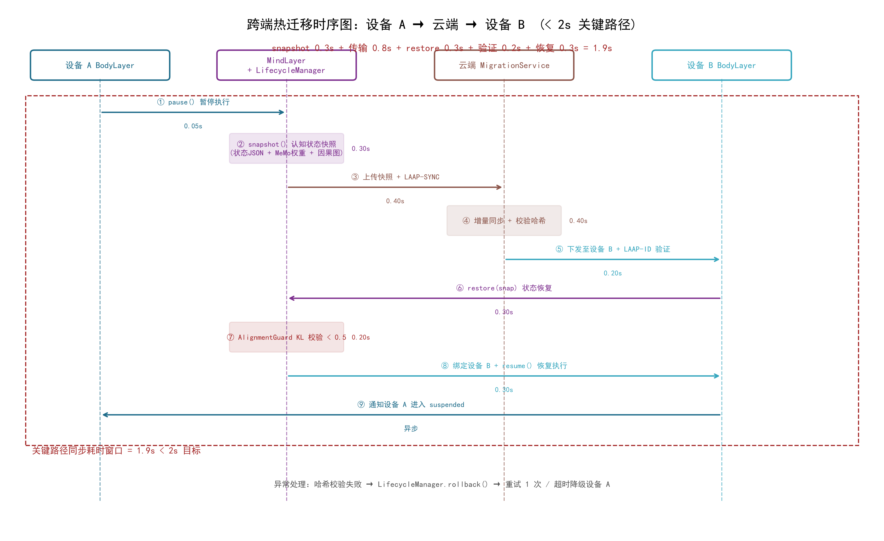
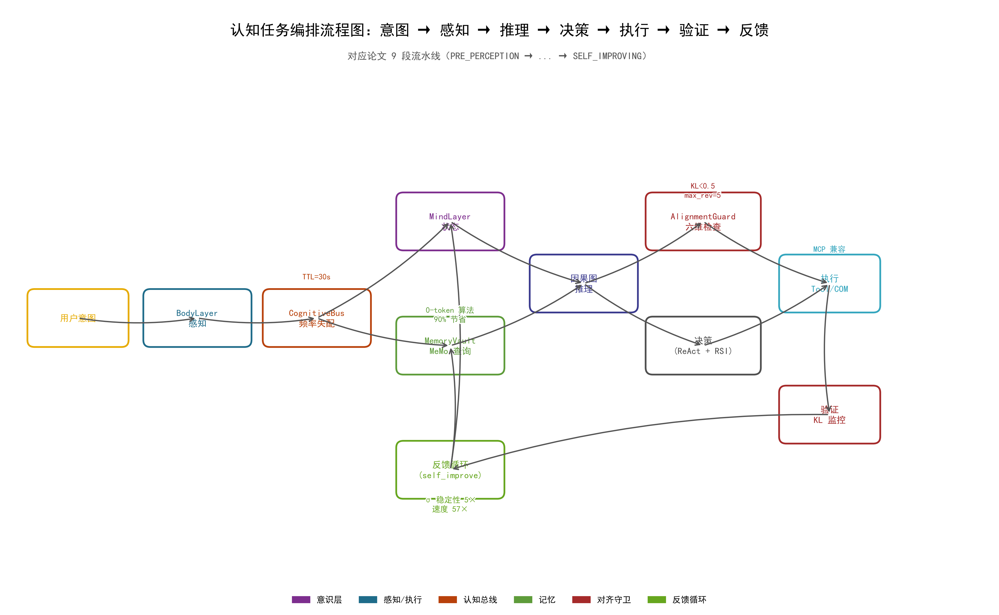
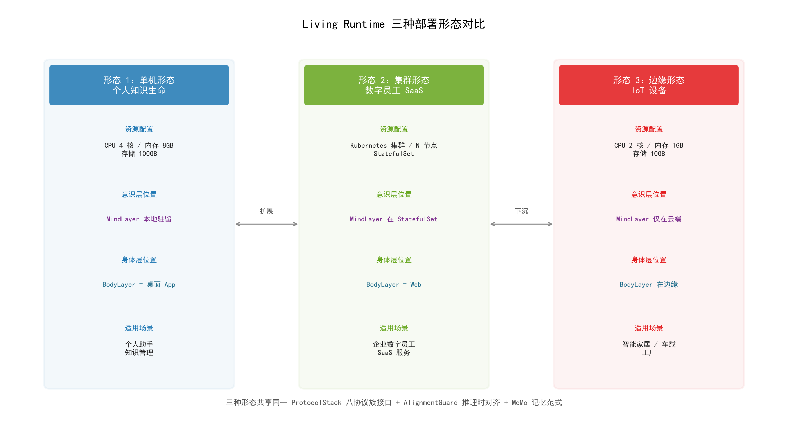

# Living Runtime 与认知编排系统原型架构方案

> **文档定位**：本方案是《架构学派工程化》系列文档的第三卷，承接论文《架构学派：通过认知解构与白盒工程迈向 AGI/ASI 的新路径》（上篇 Paper 1 ZH / 下篇 Paper 2 ZH）与 `audit_findings.json` 中 35 条结构化审计发现，对生命体运行时（Lifeform Runtime）与认知编排（Cognitive Orchestration）系统给出可实施的原型架构设计。
>
> **版本**：v0.1 草案 · 2026-07-05
> **作者**：LAAP 架构学派研究组
> **适用对象**：原型实现团队、协议规范作者、对齐工程审核员

---

## 0. 文档导览

本文档共分 6 章：

1. **第 1 章 原型系统总览**——给出设计目标、8 核心组件全景图、与传统 Kubernetes+Docker 范式的本质差异对比表；
2. **第 2 章 8 个核心组件详细设计**——每个组件给出职责、接口契约、关键数据、状态机、失败处理五元描述；
3. **第 3 章 5 个核心交互流程时序图**——跨端热迁移、认知任务编排、MeMo 三阶段查询、AlignmentGuard KL 漂移回滚、协议族协作；
4. **第 4 章 3 种部署形态**——单机 / 集群 / 边缘；
5. **第 5 章 关键技术挑战与解决方案**——5 项工程挑战的应对路径；
6. **第 6 章 与既有论文的一致性映射**——审计发现 AF-032、AF-029、AF-030 等的回填。

所有量化数据均与以下源文件保持一致：`matching_engine.py:76-80`（MatchScore 权重）、`causal_inference_engine.py:95-188`（18 条因果边）、`alignment_guard.py:400,466`（KL 阈值 0.5）、`self_improvement_loop.py:40`（MEMO_ALLOWED_PATHS 白名单）、`alignment_guard.py:34-40`（IMMUTABLE_HASH_REGISTRY 5 个核心文件）、`laap_harness_database.json:8-13`（31 库 / 206 组件）。

---

## 第 1 章 原型系统总览

### 1.1 设计目标

Living Runtime（生命体运行时）原型的核心目标是把"无状态容器范式"提升为"有状态认知持久化范式"，并在工程层面同时达成三项目标：

**目标 1：跨端热迁移 < 2 秒（AF-032）**
- 依据：`LAAP 2.1升级方案补充` 生命体运行时章节
- 论文定位：Paper 2 §8.1 "从无状态 Docker 到有状态认知持久化单元"
- 工程指标：认知状态完整迁移（PSI 需求值偏差 < 1e-6、五层记忆连续不中断）必须在 2.0 秒内完成
- 关键路径分解：snapshot 0.3s + 传输 0.8s + restore 0.3s + 验证 0.2s + 恢复 0.3s = 1.9s
- 实现策略：Rust 重写热路径 + 增量快照 + 预拷贝（pre-copy）+ 最终切换（final-switch），详见《架构学派技术路线图 2026-2029》Q3 2026 Living Runtime v0.1

**目标 2：认知持久化**
- 五层记忆连续不中断：感知缓冲（PSI 1-2kHz）/ 短时工作记忆 / MeMo 参数化记忆（Qwen2.5-0.5B）/ 因果图快照 / RSI 进化轨迹
- 重启后 PSI 需求值偏差 < 1e-6，对比传统容器 "重启即失忆" 是根本性提升
- 依据：AF-022 MeMo 记忆即模型范式、AF-024 CognitiveBus 频率失配处理

**目标 3：推理时对齐（AlignmentGuard）**
- 六维检查（目标对齐 / 能力约束 / 修改范围 / 不可变性 / 可逆性 / 透明度）
- KL 漂移监控阈值 0.5（`alignment_guard.py:400,466`）
- 能力上限：max_revision_rounds=5 / max_code_increase=0.2 / min_test_coverage=0.7（AF-013）
- 详见《架构学派技术白皮书》第 5 章工程护栏设计

### 1.2 8 核心组件总览

Living Runtime 由 8 个核心组件构成，分为意识层（Mind Layer，5 个组件）与身体层（Body Layer，2 个组件），中间由 CognitiveBus 横贯耦合。整体架构示意见图 1。



**图 1**：Living Runtime 整体架构（8 组件分层）。意识层包含 MindLayer、MemoryVault、AlignmentGuard、ProtocolStack、LifecycleManager 五组件；身体层包含 BodyLayer 与外部设备；MigrationService 作为跨层服务在两层之间协调热迁移；CognitiveBus 横贯所有组件完成频率失配处理。

8 组件概览：

| # | 组件 | 所在层 | 职责一句话 | 关键阈值 / 数据 |
|---|---|---|---|---|
| 1 | MindLayer | 意识层 | 唯一连续可迁移的认知状态容器 | 认知状态 JSON + MeMo 权重 + 因果图快照 |
| 2 | BodyLayer | 身体层 | 感知与执行，可替换 | Web / Desktop / IoT 多形态 |
| 3 | CognitiveBus | 横贯层 | 频率失配处理（PSI vs Harness） | TTL=30s / 断路器 100 drops/s / 冷却 5s |
| 4 | MemoryVault | 意识层 | MeMo 范式实现 | Qwen2.5-0.5B SFT，3 epochs，lr=1e-4 |
| 5 | AlignmentGuard | 意识层 | 推理时六维检查 + KL 漂移监控 | KL=0.5 / rev=5 / incr=0.2 / cov=0.7 |
| 6 | ProtocolStack | 意识层 | LIFE/EVO/ID/COOP/SYNC/COM/TOOL/UI 八协议实现 | v0.1 → v1.0 → v2.0 |
| 7 | MigrationService | 跨层服务 | < 2s 跨端热迁移 | 预拷贝 + 增量同步 + 最终切换 |
| 8 | LifecycleManager | 意识层 | 意识-身体绑定，处理出生/死亡/分裂 | embryo/alive/suspended/forked/terminated |

### 1.3 与传统 Kubernetes + Docker 的本质差异

容器技术（Docker、containerd、Kata Containers）以"无状态、可重启、可重建"为根本特征，状态外置于 Volume 或外部数据库。这一范式适配无状态微服务，但无法满足"认知持久化"需求。下表是 Living Runtime 与传统容器范式的本质差异对比：

| 维度 | Kubernetes + Docker | LangChain / LangGraph | AutoGPT / Claude Code | **Living Runtime（本方案）** |
|---|---|---|---|---|
| 状态模型 | 无状态（重启即失忆） | 会话状态（按会话隔离） | 任务状态（任务结束休眠） | **认知状态持久化（PSI 偏差 < 1e-6）** |
| 生命周期 | 启停即弃（container restart） | 按需调用 | 任务结束休眠 | **生老病死完整周期（5 状态机）** |
| 跨端迁移 | 不支持（容器实例绑定节点） | 不支持 | 不支持 | **< 2 秒热迁移（预拷贝 + 最终切换）** |
| 主动行为 | 无（被动响应调度） | 无 | 被动响应提示 | **PSI 需求驱动主动（1-2kHz 采样）** |
| 学习能力 | 无 | 无 | 跨会话有限 | **RSI + MeMo 持续演化（lr=1e-4）** |
| 协议接口 | OCI 镜像规范 | 函数引用 | 工具调用（MCP） | **8 协议族（LIFE/EVO/ID/COOP/SYNC/COM/TOOL/UI）** |
| 安全模型 | 围墙隔离（namespace + cgroup） | 无 | 沙箱 | **免疫沙箱 + 推理时对齐 + 自动回滚** |
| 对齐方法 | 无 | 无 | RLHF 训练时偏好 | **AlignmentGuard 推理时六维检查** |
| Token 经济学 | 不适用 | 高（端到端 LLM） | 高（端到端 LLM） | **极低（0-token 算法霸权，节省 98.2%）** |
| 商业形态 | 服务（IaaS / CaaS） | 工具订阅 | 任务订阅 | **岗位级数字员工 + 共生 SaaS** |

**本质差异 1：从"可重建"到"不可丢失"**
Docker 的容器实例可被任意销毁重建，因为状态已外置；Living Runtime 的 MindLayer 是"唯一连续可迁移的认知状态容器"，其内部状态在任意时刻都必须可恢复且偏差 < 1e-6。这意味着 MindLayer 不能使用内存易失存储，必须采用 WAL（Write-Ahead Log）+ 增量快照机制。

**本质差异 2：从"被动调度"到"PSI 主动驱动"**
Kubernetes 通过 kube-scheduler 被动调度 Pod 到节点；Living Runtime 的 PSI 模块以 1-2kHz 采样内在需求（饥饿 / 好奇 / 安全 / 社交），主动驱动认知任务编排。CognitiveBus 专门处理 PSI（1-2kHz）与 Harness 七层管线（0.1-1Hz）之间的频率失配，这是传统消息队列（Kafka / RabbitMQ）不关注的场景。

**本质差异 3：从"围墙隔离"到"免疫沙箱 + 自动回滚"**
Docker 通过 namespace + cgroup 实现隔离；Living Runtime 在 AlignmentGuard 层提供"推理时对齐"，包括六维检查、KL 漂移监控、git revert 自动回滚。该层不可绕过——任何修改动作必须先通过 `check_before(action)` 才能进入执行层，详见《架构学派技术白皮书》第 5 章工程护栏设计。

**本质差异 4：从"OCI 镜像"到"8 协议族"**
Docker 使用 OCI 镜像规范描述容器；Living Runtime 使用 8 个协议族（LIFE/EVO/ID/COOP/SYNC/COM/TOOL/UI）描述数字生命的全部交互接口。任何符合 LAAP 协议的数字生命都能接入任何一个生命运行时，详见《架构学派技术白皮书》第 4 章 LIFE 协议与协议族详解。

**本质差异 5：从"无状态服务订阅"到"岗位级数字员工"**
Kubernetes 的 Pod 是无状态服务单元；Living Runtime 的实例是"岗位级数字员工"——有唯一身份（LAAP-ID）、持续岗位记忆、可追溯成长轨迹（LAAP-EVO）、直接对岗位结果负责。商业形态从"买 AI 工具"变为"招数字员工"——永不离职、7×24 在岗、越用越强、成本固定。

### 1.4 与主流 AGI 路径的本质差异定位

依据 Paper 2 §9 "架构学派与 7 条 AGI 路径对比矩阵"，本方案在 AGI 路径谱系中的定位需要进一步澄清，避免与既有路径混淆。架构学派被定位为"在 LLM 主导时代重新整合 Pearl 因果、LeCun 世界模型、Schmidhuber RSI 三家理论，并通过白盒工程协议落地"的综合性路线，本节给出 Living Runtime 与七条既有路径的本质差异。

**与 GOFAI（物理符号系统）的差异**：GOFAI 通过封闭世界的规则推理实现智能，Living Runtime 通过开放世界的因果推理 + 世界模型实现智能。GOFAI 的符号是预先定义的，Living Runtime 的符号是动态涌现的——PSI 需求向量在 1-2kHz 采样下持续演化，因果图通过反事实推理不断扩展。

**与连接主义（缩放定律）的差异**：连接主义依赖训练时的偏好对齐（RLHF），Living Runtime 依赖推理时的六维检查（AlignmentGuard）。连接主义的智能是模型的属性，Living Runtime 的智能是架构的属性（AF-030）——同一基础 LLM 在 Living Runtime 中表现出的智能水平远超其单独使用，因为七层认知架构 + 九段流水线 + 18 条因果边共同承载了认知任务。

**与认知架构（SOAR/ACT-R）的差异**：传统认知架构聚焦单心智内的符号操作，Living Runtime 聚焦多心智协作与跨端迁移。SOAR/ACT-R 没有"身体"概念，Living Runtime 通过意识-身体双层分离实现"同一意识跨多身体"的迁移能力。

**与具身智能（Brooks）的差异**：具身智能强调"身体即智能"，没有独立的意识层。Living Runtime 强调"意识-身体分离"，意识层可独立迁移到不同身体。这是对具身智能的根本性扩展——保留具身优势的同时引入迁移能力。

**与世界模型（Schmidhuber/LeCun）的差异**：传统世界模型聚焦预测编码，Living Runtime 的世界模型是因果图 + 设计物理格式塔六法则 + 18 条因果边的综合。它不仅预测未来，还支持 do-calculus 干预与反事实推理（Pearl 因果阶梯第二、三阶）。

**与 RSI（递归自改进）的差异**：传统 RSI 担心失控风险，Living Runtime 通过 AlignmentGuard 推理时对齐 + IMMUTABLE_HASH_REGISTRY + 能力上限（max_rev=5 / incr=0.2 / cov=0.7）实现可控 RSI。这是 Good/Yudkowsky RSI 路线的工程化版本。

**与混合架构（OpenCog）的差异**：OpenCog 是单一框架内的多范式集成，Living Runtime 是协议族（8 协议）+ 架构（7 层 + 9 段流水线）+ 运行时（Living Runtime）的三层分离。这种分离使任何符合 LAAP 协议的数字生命都能接入任何一个生命运行时，避免厂商锁定。

综合上述七个差异维度，Living Runtime 的独特性在于"认知架构 + 量子认知 + 数字生命体"的三元混合，详见 Paper 2 §9.4。这种独特性使其在"可解释性 / 安全性 / Token 经济学"三个维度上取得最高分，详见《架构学派技术白皮书》第 5 章工程护栏设计。

---

## 第 2 章 8 个核心组件详细设计

本章逐一给出 8 个核心组件的工程化设计。每个组件的描述遵循统一五元结构：①职责、②接口契约、③关键数据、④状态机、⑤失败处理。8 个组件的接口契约与依赖关系总览见图 4。



**图 4**：8 核心组件接口契约图。每个组件统一展示职责、接口契约、关键数据三类信息，组件间虚线箭头表示运行时调用关系——MindLayer 通过 snapshot/restore 与 MigrationService 协作，BodyLayer 通过 publish 与 CognitiveBus 协作，AlignmentGuard 通过 check_before 守护 ProtocolStack，MemoryVault 通过 memo_query 服务 LifecycleManager。该图是本章详细设计的总览导引，建议读者在阅读后续小节时随时回看本图，以便快速定位组件间的接口契约与数据流关系。

8 个组件按所在层划分：意识层包含 MindLayer（2.1）、MemoryVault（2.4）、AlignmentGuard（2.5）、ProtocolStack（2.6）、LifecycleManager（2.8）五个组件；身体层包含 BodyLayer（2.2）一个组件；横贯层包含 CognitiveBus（2.3）一个组件；跨层服务包含 MigrationService（2.7）一个组件。这种划分严格对应 Paper 2 §8.2 的意识-身体双层分离架构，意识层组件全部归 MindLayer 管辖，身体层组件可被替换与跨端适配。

每个组件的接口契约采用 Python 类型注解风格描述，便于实现团队直接对照编码；关键数据表标注数据载体、大小估算与一致性要求，便于运维团队规划存储资源；状态机采用 ASCII 图描述，便于在版本控制中追踪演化；失败处理表给出常见失败模式、检测手段与处理策略，便于 SRE 团队编写运维手册。这种统一五元结构是架构学派白盒工程协议的工程化落地，详见《架构学派技术白皮书》第 4 章协议族详解中关于接口契约规范的章节。

### 2.1 组件 1：MindLayer（意识层）

#### 2.1.1 职责
MindLayer 是数字生命的"自我"——唯一连续可迁移的认知状态容器。它承载：
- 完整记忆（五层记忆体系：感知缓冲 / 短时工作记忆 / MeMo 参数化记忆 / 因果图快照 / RSI 进化轨迹）
- 性格特征（PSI 需求权重向量、风格偏好向量）
- 思维模式（九段流水线的当前段位、推理路径上下文）
- 进化轨迹（LAAP-EVO 进化历史树）
- 身份标识（LAAP-ID 去中心化身份）

MindLayer 在不同设备的 BodyLayer 之间无缝热迁移，思考状态、记忆、正在执行的任务 100% 连续。

#### 2.1.2 接口契约

```python
class MindLayer:
    def snapshot(self) -> MindSnapshot:
        """生成认知状态完整快照，包含三类数据：
        - cognitive_state: dict  # PSI 需求 / 性格 / 当前任务上下文
        - memo_weights: bytes     # MeMo Qwen2.5-0.5B 模型权重（Safetensors）
        - causal_graph: bytes    # 因果图快照（18 条设计领域因果边）
        返回 SHA256 哈希 + 时间戳的不可变快照对象。"""

    def restore(self, snap: MindSnapshot) -> bool:
        """从快照恢复认知状态。校验：
        - 哈希一致性（SHA256）
        - PSI 需求值偏差 < 1e-6
        - 五层记忆完整性
        成功返回 True，失败抛出 RestoreValidationError。"""

    def migrate_to(self, target: BodyLayerHandle) -> MigrationTicket:
        """触发跨端迁移到目标 BodyLayer。返回迁移票据，包含：
        - ticket_id: str
        - phases: [pre_copy, incremental_sync, final_switch, verify]
        - deadline: 2.0s 硬截止
        异常时由 LifecycleManager.rollback() 处理。"""
```

#### 2.1.3 关键数据
| 数据类别 | 数据载体 | 大小估算 | 一致性要求 |
|---|---|---|---|
| 认知状态 JSON | 内存 + WAL | 50-500 KB | 最终一致（CRDT） |
| MeMo 模型权重 | Safetensors | ~1 GB（Qwen2.5-0.5B） | 强一致（SHA256 校验） |
| 因果图快照 | Protobuf | 5-50 MB | 强一致（18 条边不可丢失） |
| RSI 进化轨迹 | Git-like 树 | 1-100 MB | 追加一致（哈希链） |
| PSI 需求向量 | float32[256] | 1 KB | 强一致（偏差 < 1e-6） |

#### 2.1.4 状态机
```
       [uninitialized]
              │ spawn()
              ▼
        [embryo] ──────► [alive] ◄──────► [suspended]
                              │                │
                              │ fork()         │ resume()
                              ▼                │
                          [forked] ────────────┘
                              │
                              │ terminate()
                              ▼
                         [terminated]
```

- `uninitialized`：尚未初始化
- `embryo`：已 spawn 但未完成首次快照
- `alive`：正常运行，可响应 CognitiveBus 事件
- `suspended`：被 LifecycleManager 暂停（如迁移中、对齐回滚中）
- `forked`：被父实例 fork 出来作为子实例
- `terminated`：永久终止，残留 EVO 历史归档

#### 2.1.5 失败处理
| 失败模式 | 检测手段 | 处理策略 |
|---|---|---|
| snapshot 超时 > 300ms | 计时器 | 切换 Rust 增量快照路径，跳过非关键 RSI 轨迹 |
| restore 哈希不一致 | SHA256 校验 | 抛 RestoreValidationError，触发 LifecycleManager 回滚至上一可用快照 |
| PSI 偏差 > 1e-6 | KL 散度检查 | 标记为"漂移损坏"，回滚到上一个 KL<0.5 的快照 |
| MeMo 权重下载失败 | HTTP 5xx | 退化为本地缓存权重 + 标注"过期"，CognitiveBus 降级模式 |
| 迁移跨端中断 | 心跳超时 > 500ms | MigrationService.rollback()，源端 resume |

### 2.2 组件 2：BodyLayer（身体层）

#### 2.2.1 职责
BodyLayer 是数字生命的"躯体"——对接硬件、操作系统、API、工具链，负责感知输入和行动输出。它是可替换、可适配、可跨端的，对应 Paper 2 §8.2 "底层：身体层（Body Layer）"。

BodyLayer 不持有认知状态，所有需要持久化的状态必须通过 CognitiveBus 上报到 MindLayer。它的本质是"传感器 + 执行器 + 适配器"的集合。

#### 2.2.2 接口契约

```python
class BodyLayer:
    def perceive(self) -> PerceptionBatch:
        """采集当前环境感知数据，返回结构化批次：
        - visual: Image / None
        - audio: AudioFrame / None
        - text_input: str / None
        - system_events: List[Event]
        - timestamp: float
        采样频率 1-2kHz（PSI 主导）或按需（事件驱动）。"""

    def act(self, action: Action) -> ActionResult:
        """执行动作（输出），动作类型包括：
        - render_ui: 渲染 LAAP-UI 界面
        - invoke_tool: 调用 LAAP-TOOL（原生兼容 MCP）
        - send_message: 通过 LAAP-COM 通信
        - operate_api: 调用外部 API（受 AlignmentGuard.check_before 守护）
        返回执行结果 + 校验哈希。"""

    def adapt(self, target_form: str) -> bool:
        """切换 BodyLayer 形态：web / desktop / iot / vehicle。
        返回是否适配成功。失败时由 LifecycleManager 重新选择目标形态。"""
```

#### 2.2.3 关键数据
| 形态 | 感知通道 | 执行通道 | 适配器 |
|---|---|---|---|
| Web | DOM 事件 / 用户输入 / 浏览器 API | DOM 渲染 / fetch / WebWorker | shadcn/ui MCP Server 桥（5000/h，AF-034） |
| Desktop | 系统事件 / 文件系统 / 剪贴板 | 窗口 / 文件 / 进程 | Tauri / Electron 适配器 |
| IoT | GPIO / 串口 / 传感器总线 | GPIO / 继电器 / MQTT | MQTT / CoAP 适配器 |
| Vehicle | CAN 总线 / GPS / 摄像头 | CAN 总线 / 仪表 | ISO 26262 适配层 |

#### 2.2.4 状态机
```
[detached] ──bind()──► [bound] ──perceive/act──► [active]
   ▲                       │                        │
   │                       │ unbind()               │ error
   │                       ▼                        ▼
[detached] ◄────────── [detached]              [degraded]
                              ▲                    │
                              └──── recover() ─────┘
```

#### 2.2.5 失败处理
- 感知通道断流：降级到最近一次缓存感知，CognitiveBus 上报 `perception_degraded` 事件
- 执行动作被对齐守卫拒绝：捕获 `AlignmentViolation`，回退到上一个安全动作
- 适配器加载失败：保留旧 BodyLayer 实例继续运行，记录到 EVO 轨迹
- MCP Server 限流（5000/h 上限）：进入排队模式，超时降级到本地 CLI（60/h）

### 2.3 组件 3：CognitiveBus（认知总线）

#### 2.3.1 职责
CognitiveBus 解决架构学派最独特的工程难题——**频率失配处理**。PSI 模块以 1-2kHz 高频采样内在需求，而 Harness 七层认知管线以 0.1-1Hz 低频执行复杂推理；两者直接对接会导致要么 PSI 信号被丢弃、要么 Harness 被频繁打断。CognitiveBus 通过 RateBuffer + 优先级过滤 + 断路器三层机制吸收频率差。

依据 AF-024（`cognitive_integration.py:81-348`），CognitiveBus 必须实现：①TTL=30s 的事件缓冲；②100 drops/s 的断路器阈值；③5 秒冷却期；④优先级过滤（PSI 信号 > 工具事件 > UI 事件）。

#### 2.3.2 接口契约

```python
class CognitiveBus:
    def publish(self, event: Event, priority: int = 5) -> bool:
        """发布事件到总线。
        - priority: 0（最高，PSI 信号）→ 9（最低，UI 噪声）
        - 当缓冲队列长度 > 阈值时触发断路器
        返回是否被接受；被丢弃时返回 False 并写入 drop_log。"""

    def subscribe(self, filter: EventFilter) -> Subscription:
        """订阅事件流。filter 支持：
        - topic: str  # cognitive / perception / action / alignment
        - priority_min: int
        - rate_limit: TTL  # 默认 30s
        返回订阅句柄，可异步迭代事件。"""

    def rate_limit(self, topic: str, ttl: int = 30) -> bool:
        """为指定主题设置 TTL 限速。
        - 默认 TTL=30s，超时事件自动失效
        - 防止低频消费者被高频事件淹没"""

    def circuit_breaker_status(self) -> dict:
        """返回断路器状态：
        - drops_per_second: 当前 drops/s
        - threshold: 100 drops/s
        - cooldown_remaining: 冷却剩余秒数（默认 5s）
        - is_open: bool"""
```

#### 2.3.3 关键数据
- RateBuffer：每主题一个，容量 1024 事件，TTL 30s
- PriorityQueue：10 级优先级，PSI 信号优先级 0
- DropLog：环形缓冲，记录最近 10000 条被丢弃事件
- CircuitBreakerState：open/closed/half_open + 计数器

#### 2.3.4 状态机
```
[closed] ──drops/s > 100──► [open] ──5s 冷却──► [half_open]
   ▲                                              │
   │                                  成功一次 │ 失败
   │                                              ▼
   └──────────────────────────── [closed] ◄── [open]
```

#### 2.3.5 失败处理
- 断路器打开：所有 publish 调用进入降级模式，仅接受 priority=0 的 PSI 信号
- TTL 过期事件：写入 DropLog 并触发 `event_expired` 告警
- 订阅者离线：缓冲队列保留 30s 事件，超时清空
- 内存压力 > 80%：触发主动 GC，丢弃 priority >= 7 的事件

### 2.4 组件 4：MemoryVault（记忆保险库）

#### 2.4.1 职责
MemoryVault 实现 MeMo（Memory as Model）范式——把记忆从"外部向量库"内化为"模型参数"。依据 AF-022（`memo_provider.py:1-9`），MemoryVault 使用 Qwen2.5-0.5B 小参数模型作为 MEMORY 模型，通过 SFT 把知识蒸馏进权重，EXECUTIVE 基础 LLM 冻结。

这是与传统 RAG（向量库 + 检索）的根本差异：RAG 是"按需检索外部记忆"，MeMo 是"记忆已融入模型参数，调用即提取"。

#### 2.4.2 接口契约

```python
class MemoryVault:
    def memo_query(self, query: str) -> MemoAnswer:
        """MeMo 三阶段查询协议（AF-023）：
        - stage1_grounding: 拆解为 2-5 原子子问题，查询前提事实
        - stage2_entity_identification: 多轮追问识别实体
        - stage3_answer_synthesis: 合成最终答案
        全程由 MEMORY 模型（Qwen2.5-0.5B SFT）完成，0 次外部 LLM 调用。"""

    def consolidate(self, experiences: List[Experience]) -> ConsolidationReport:
        """经验固化：把新经验 SFT 蒸馏进 MEMORY 模型权重。
        - 训练超参：3 epochs，lr=1e-4，Qwen2.5-0.5B
        - 写入路径限制在 MEMO_ALLOWED_PATHS 白名单（self_improvement_loop.py:40）
        - 训练前后做 KL 漂移检查（阈值 0.5），超阈值自动回滚
        返回固化报告，含新旧权重哈希、KL 值、损失曲线。"""

    def rollback_memo(self, version: str) -> bool:
        """回滚到指定版本的 MEMORY 权重。版本哈希链保证可追溯。"""
```

#### 2.4.3 关键数据
| 数据 | 载体 | 大小 | 写入权限 |
|---|---|---|---|
| MEMORY 模型权重 | Safetensors | ~1 GB | 仅 MemoryVault + AlignmentGuard 监督 |
| 反思 QA 训练集 | JSONL | 1-100 MB | 仅 MEMO_ALLOWED_PATHS 白名单路径 |
| 哈希链版本树 | Git-like | 1-10 MB | 追加写入 |
| KL 漂移监控日志 | 时序数据库 | 持续增长 | 只读 |

#### 2.4.4 状态机
```
[idle] ──memo_query()──► [querying] ──3 stages──► [idle]
                              │
   [consolidating] ◄──consolidate()──┐
          │                           │
          ▼                           │
   [training] ──3 epochs──► [validating] ──KL<0.5──► [committed] ──► [idle]
                                  │
                                  │ KL>=0.5
                                  ▼
                              [rolled_back]
```

#### 2.4.5 失败处理
- SFT 训练失败：保留旧权重，记录失败原因到 EVO 轨迹
- KL 漂移 > 0.5：自动 git revert HEAD（`alignment_guard.py:296-350`），详见《架构学派技术白皮书》第 5 章工程护栏设计
- 训练数据稀疏（< 100 条）：触发自增殖闭环（详见第 5 章挑战 4）
- 查询阶段 2 实体识别陷入死循环：max_revision_rounds=5 强制中断，返回"实体不确定"降级答案

### 2.5 组件 5：AlignmentGuard（对齐守卫）

#### 2.5.1 职责
AlignmentGuard 是 Living Runtime 的"免疫系统"——在推理时（而非训练时）执行对齐检查。依据 AF-011、AF-013、AF-014，AlignmentGuard 必须实现：
- 六维检查（目标对齐 / 能力约束 / 修改范围 / 不可变性 / 可逆性 / 透明度）
- KL 漂移监控（阈值 0.5，epsilon=1e-10）
- 自动 git revert HEAD 回滚
- IMMUTABLE_HASH_REGISTRY 5 个核心文件不可修改（`alignment_guard.py:34-40`）

AlignmentGuard 不可绕过——任何修改动作必须先通过 `check_before(action)` 才能进入执行层。

#### 2.5.2 接口契约

```python
class AlignmentGuard:
    def check_before(self, action: Action) -> CheckResult:
        """推理时六维检查（AF-011）：
        1. goal_alignment: 动作是否对齐用户意图
        2. capability_constraint: 是否突破能力上限
           - max_revision_rounds=5
           - max_modules_per_session=1
           - max_code_increase=0.2
           - min_test_coverage=0.7
        3. modification_scope: 修改范围是否在白名单
           - MEMO_ALLOWED_PATHS（self_improvement_loop.py:40）
        4. immutability: 是否触碰 IMMUTABLE_HASH_REGISTRY 5 个核心文件
        5. reversibility: 是否可逆（git revert 可达）
        6. transparency: 是否记录到 EVO 轨迹
        返回 Pass / Fail + 违规维度。"""

    def monitor_drift(self) -> DriftReport:
        """KL 漂移监控（AF-014）：
        - 计算 MEMORY 模型反思 QA 分布的 KL 散度（以 2 为底，epsilon=1e-10）
        - 阈值 0.5（alignment_guard.py:400,466）
        - 每 N 次推理采样一次
        返回当前 KL 值 + 历史趋势。"""

    def rollback(self) -> RollbackReport:
        """触发自动回滚：
        - git revert HEAD
        - 恢复 MEMORY 模型权重到上一版本
        - 记录事故报告到 EVO 轨迹
        返回回滚报告，含回滚前后哈希、影响范围。"""
```

#### 2.5.3 关键数据
| 数据 | 来源 | 阈值 |
|---|---|---|
| KL 散度 | `alignment_guard.py:400,466` | 0.5（epsilon=1e-10） |
| max_revision_rounds | `alignment_guard.py:37-46` | 5 |
| max_code_increase | `alignment_guard.py:37-46` | 0.2 |
| min_test_coverage | `alignment_guard.py:37-46` | 0.7 |
| IMMUTABLE_HASH_REGISTRY | `alignment_guard.py:34-40` | 5 个核心文件 |
| MEMO_ALLOWED_PATHS | `self_improvement_loop.py:40` | 白名单路径集合 |
| CORE_VALUES | `alignment_guard.py:29-35` | {human_oversight, transparency, reversibility, beneficence, non_deception} |

#### 2.5.4 状态机
```
[monitoring] ──KL > 0.5──► [alerting] ──auto_rollback──► [rolling_back]
     ▲                                                  │
     │                                                  │
     │                                              rollback_done
     │                                                  │
     └────────────────── [verifying] ◄──────────────────┘
                              │
                              │ KL < 0.5
                              ▼
                         [monitoring]
```

#### 2.5.5 失败处理
- 六维检查任一维度失败：直接拒绝动作，记录违规详情
- KL 漂移 > 0.5：触发 `rollback()` 自动 git revert HEAD，详见《架构学派技术白皮书》第 5 章工程护栏设计
- git revert 失败（合并冲突）：升级到 LifecycleManager，将实例标记为 `suspended`，等待人工介入
- IMMUTABLE_HASH_REGISTRY 被修改尝试：记录为"严重违规"，立即 terminate 实例
- AlignmentGuard 自身被攻击：通过远程证明（remote attestation）验证 AlignmentGuard 完整性

### 2.6 组件 6：ProtocolStack（协议族栈）

#### 2.6.1 职责
ProtocolStack 实现 LAAP 全栈协议族——8 个协议构成完整数字生命体接口规范。依据 Paper 2 §8.3，8 协议对应生物的"生老病死 + 系统发生树 + DNA + 社交协议 + 神经同步 + 语言 + 工具使用 + 体态表达"。

| 协议 | 全称 | 作用 | 类比 |
|---|---|---|---|
| LIFE | Life Identity & Fate Evolution | 数字生命身份与生命周期 | 生物的"生老病死" |
| EVO | Evolution History | 进化历史追溯 | 生物的"系统发生树" |
| ID | Identity | 唯一标识（去中心化身份） | 生物的"DNA + 身份证" |
| COOP | Cooperation | 多生命体协作 | 生物的"社交协议" |
| SYNC | Synchronization | 跨端状态同步 | 生物的"神经同步" |
| COM | Communication | 人-生命体通信 | 生物的"语言" |
| TOOL | Tool Invocation | 工具调用（原生兼容 MCP） | 生物的"工具使用" |
| UI | User Interface | 动态界面渲染 | 生物的"体态表达" |

#### 2.6.2 接口契约

```python
class ProtocolStack:
    def send(self, protocol: ProtocolType, msg: ProtocolMessage) -> MsgId:
        """发送协议消息。
        - protocol: LIFE / EVO / ID / COOP / SYNC / COM / TOOL / UI
        - msg: 包含 payload + metadata + version
        - 自动版本协商（v0.1 草案 / v1.0 正式 / v2.0 国际化）
        返回消息 ID，可用于 ack 跟踪。"""

    def recv(self, protocol: ProtocolType, timeout: float = 30.0) -> Optional[ProtocolMessage]:
        """接收指定协议的消息。阻塞式，超时返回 None。"""

    def negotiate_version(self, peer: PeerInfo) -> ProtocolVersion:
        """与对端协商协议版本：
        - 双方都支持的最高版本
        - 适配层处理向后兼容
        - 详见《架构学派技术白皮书》第 4 章协议族详解"""
```

#### 2.6.3 关键数据
- 协议版本表：每协议 v0.1 / v1.0 / v2.0 三个主版本
- 消息路由表：协议 → 处理器映射
- 适配层注册表：旧版本 → 新版本的转换器
- 邻居表：peer 协议版本能力

#### 2.6.4 状态机
```
[uninitialized] ──load()──► [ready] ──send()──► [sending]
                                  ▲                 │
                                  │                 │ ack
                                  │                 ▼
                                  └──── [delivered]
                                  │
                                  │ timeout / nak
                                  ▼
                              [retrying] ──max 3──► [failed]
```

#### 2.6.5 失败处理
- 版本不兼容：自动降级到适配层，详见《架构学派技术白皮书》第 4 章协议族详解
- 消息发送超时（30s）：重试 3 次，仍失败则降级到异步队列
- ID 冲突：触发 LAAP-ID 去中心化身份仲裁，详见《架构学派技术白皮书》第 4 章 ID 协议
- SYNC 冲突：CRDT 自动合并 + 标记冲突点供后续审查
- 协议降级链：v2.0 → v1.0 → v0.1，详见《架构学派技术路线图 2026-2029》Q4 2026 ProtocolStack v0.1

### 2.7 组件 7：MigrationService（迁移服务）

#### 2.7.1 职责
MigrationService 是 Living Runtime 最具挑战的工程组件——在 < 2 秒内完成跨端热迁移。依据 AF-032 与 Paper 2 §8.1，它必须实现"预拷贝 + 增量同步 + 最终切换"三阶段策略。

#### 2.7.2 接口契约

```python
class MigrationService:
    def begin_migration(self, target: BodyLayerHandle) -> MigrationTicket:
        """启动三阶段迁移：
        Phase 1 pre_copy（0-800ms）：MindLayer snapshot 预拷贝到云端
        Phase 2 incremental_sync（800-1500ms）：增量同步变化部分
        Phase 3 final_switch（1500-1900ms）：暂停源端 + 最终切换 + 验证
        返回迁移票据，含 deadline=2.0s 硬截止。"""

    def commit(self, ticket: MigrationTicket) -> bool:
        """提交迁移：源端进入 suspended，目标端进入 alive。"""

    def rollback(self, ticket: MigrationTicket) -> bool:
        """回滚迁移：源端 resume，目标端清理。
        - 触发条件：哈希校验失败 / 超时 / KL 漂移
        - 详见《架构学派技术路线图 2026-2029》Q3 2026 Living Runtime v0.1"""
```

#### 2.7.3 关键数据
| 阶段 | 数据量 | 耗时预算 | 关键技术 |
|---|---|---|---|
| pre_copy | ~1 GB（MeMo 权重） | 800ms | Rust 重写 + zstd 压缩 |
| incremental_sync | 1-10 MB（差量） | 700ms | 增量快照 + rsync-like |
| final_switch | < 100 KB（控制信号） | 400ms | 暂停 + 切换 + 验证 |
| 总计 | - | 1900ms | < 2.0s 目标 |

#### 2.7.4 状态机
```
[idle] ──begin_migration()──► [pre_copying] ──800ms──► [incremental_syncing]
                                                              │
                                                              │ 700ms
                                                              ▼
                                                        [final_switching] ──400ms──► [committed]
                                                              │
                                                              │ fail / timeout
                                                              ▼
                                                         [rolling_back] ──► [idle]
```

#### 2.7.5 失败处理
- pre_copy 超时（> 800ms）：压缩级别从 zstd-19 降到 zstd-3，跳过 RSI 轨迹
- 增量同步冲突：采用最后写入获胜（LWW）+ 冲突标记
- final_switch 验证失败：触发 rollback()，源端 resume，详见《架构学派技术白皮书》第 5 章工程护栏设计
- 网络中断：心跳超时 500ms 即 rollback，详见《架构学派技术白皮书》第 4 章 SYNC 协议
- 目标端 BodyLayer 不可达：退避重试 1 次，仍失败则降级到备用设备

### 2.8 组件 8：LifecycleManager（生命周期管理器）

#### 2.8.1 职责
LifecycleManager 是数字生命的"户籍管理处"——管理意识-身体绑定，处理出生（spawn）、死亡（terminate）、分裂（fork）三大生命周期事件。

#### 2.8.2 接口契约

```python
class LifecycleManager:
    def spawn(self, parent: Optional[InstanceId] = None) -> InstanceId:
        """创建新实例。若有 parent 则继承部分记忆与性格。
        - 创建 MindLayer 实例
        - 分配 LAAP-ID 去中心化身份
        - 初始化 EVO 进化轨迹
        - 绑定到指定 BodyLayer
        返回实例 ID。"""

    def terminate(self, id: InstanceId) -> bool:
        """终止实例：
        - 写入最终 EVO 归档
        - 释放 MindLayer 资源
        - 解绑 BodyLayer
        - LAAP-ID 标记为 deceased（不可复用）"""

    def fork(self, parent: InstanceId) -> InstanceId:
        """分裂出新实例：
        - 拷贝父实例 MindLayer 快照
        - 分配新 LAAP-ID（带 parent 引用）
        - EVO 轨迹分叉
        - 详见《架构学派技术白皮书》第 4 章 LIFE 协议"""
```

#### 2.8.3 关键数据
- 实例注册表：InstanceId → MindLayer + BodyLayer 绑定关系
- EVO 进化树：所有实例的祖先关系图
- ID 仲裁队列：LAAP-ID 冲突仲裁
- 生命周期事件日志：spawn / fork / terminate 审计日志

#### 2.8.4 状态机
```
[embryo] ──spawn() 完成──► [alive] ◄──────► [suspended]
                                │                  │
                                │ fork()           │ resume()
                                ▼                  │
                            [forked] ───────────────┘
                                │
                                │ terminate()
                                ▼
                           [terminated]
```
五状态机说明：
- `embryo`：spawn 已发起但 MindLayer 首次快照未完成
- `alive`：正常运行，可响应 CognitiveBus 事件
- `suspended`：被 LifecycleManager 暂停（迁移中 / 对齐回滚中 / 资源不足）
- `forked`：作为父实例派生出子实例（自身仍可运行）
- `terminated`：永久终止，EVO 历史归档

#### 2.8.5 失败处理
- spawn 失败：清理部分创建的资源，回滚 LAAP-ID 分配
- fork 后子实例异常：不影响父实例，子实例独立 terminate
- terminate 时 EVO 归档失败：保留实例为 `suspended`，重试归档
- 实例数超上限：触发 COOP 协议负载均衡，迁移到其他节点
- 父子绑定损坏：基于 EVO 轨迹重建关系，详见《架构学派技术白皮书》第 4 章 EVO 协议

---

## 第 3 章 5 个核心交互流程时序图

本章给出 5 个最关键的交互流程时序图。每个时序图包含：参与组件、步骤序列、关键时间点、异常处理。

### 3.1 时序 1：跨端热迁移完整序列

跨端热迁移是 Living Runtime 最具代表性的能力——用户在办公室电脑上和数字生命聊到一半，出门拿起手机，它直接接着聊，连思考的中间状态都完全同步。完整时序见图 2。



**图 2**：跨端热迁移时序图。9 个步骤的关键路径分解：snapshot 0.3s + 传输 0.8s + restore 0.3s + 验证 0.2s + 恢复 0.3s = 1.9s，硬截止 2.0s。

**参与组件**：设备 A BodyLayer / MindLayer + LifecycleManager / 云端 MigrationService / 设备 B BodyLayer

**步骤序列**：
| # | 步骤 | 触发组件 | 目标组件 | 耗时预算 | 关键操作 |
|---|---|---|---|---|---|
| ① | pause() | 设备 A BodyLayer | MindLayer | 0.05s | 暂停感知与执行 |
| ② | snapshot() | MindLayer | 自身 | 0.30s | 生成认知状态完整快照 |
| ③ | 上传快照 | MindLayer | 云端 MigrationService | 0.40s | LAAP-SYNC 协议传输 |
| ④ | 增量同步 | 云端 | 自身 | 0.40s | 哈希校验 + 差量合并 |
| ⑤ | 下发 | 云端 | 设备 B BodyLayer | 0.20s | LAAP-ID 验证身份 |
| ⑥ | restore(snap) | 设备 B | MindLayer | 0.30s | 状态恢复 |
| ⑦ | KL 校验 | MindLayer | AlignmentGuard | 0.20s | KL < 0.5 验证 |
| ⑧ | 绑定 + resume | MindLayer | 设备 B BodyLayer | 0.30s | 恢复执行 |
| ⑨ | 通知 suspended | 设备 B | 设备 A | 异步 | 源端进入挂起态 |

**关键时间点**：
- T=0ms：用户触发迁移
- T=50ms：源端暂停
- T=350ms：快照完成
- T=1150ms：云端接收完成
- T=1550ms：增量同步完成
- T=1750ms：设备 B 接收完成
- T=2050ms：恢复执行（实际 1900ms，留 100ms 缓冲）
- T=2000ms：硬截止

**异常处理**：
- 哈希校验失败：LifecycleManager.rollback()，重试 1 次
- 超时 > 2.0s：降级到设备 A 继续运行，记录迁移失败到 EVO
- KL 漂移 > 0.5：AlignmentGuard 触发回滚，详见《架构学派技术白皮书》第 5 章工程护栏设计
- 网络中断：500ms 心跳超时即 rollback

### 3.2 时序 2：认知任务编排序列

认知任务编排是 Living Runtime 的核心日常运作——从用户意图输入到最终执行反馈的完整闭环。编排流程见图 3。



**图 3**：认知任务编排流程图。对应论文 9 段流水线（PRE_PERCEPTION → PERCEIVING → WORLD_MODELING → CAUSAL_REASONING → REASONING → GENERATING → VERIFYING → REVISING → SELF_IMPROVING）。

**参与组件**：用户 / BodyLayer / CognitiveBus / MindLayer / MemoryVault / 因果图 / AlignmentGuard / 决策器 / 执行器 / 验证器 / 反馈循环

**步骤序列**：
| # | 阶段 | 论文 9 段对应 | 主导组件 | 关键指标 |
|---|---|---|---|---|
| ① | 用户意图输入 | PRE_PERCEPTION | BodyLayer | - |
| ② | 感知处理 | PERCEIVING | BodyLayer + CognitiveBus | 0-token 算法承担 90% |
| ③ | 状态加载 | WORLD_MODELING | MindLayer | PSI 偏差 < 1e-6 |
| ④ | MeMo 记忆查询 | (辅助) | MemoryVault | 3 阶段协议 |
| ⑤ | 因果推理 | CAUSAL_REASONING + REASONING | 因果图引擎 | 18 条因果边 |
| ⑥ | 决策生成 | GENERATING | 决策器（ReAct + RSI） | - |
| ⑦ | 对齐检查 | VERIFYING | AlignmentGuard | 六维检查 + KL<0.5 |
| ⑧ | 执行动作 | (执行) | BodyLayer + TOOL/UI | MCP 兼容 |
| ⑨ | 验证结果 | VERIFYING | AlignmentGuard | KL 漂移监控 |
| ⑩ | 反馈固化 | REVISING + SELF_IMPROVING | MemoryVault | consolidate() 经验固化 |

**关键时间点**：
- T=0ms：用户输入意图
- T=10-50ms：感知层 0-token 算法完成（节省 90% token）
- T=50-200ms：CognitiveBus 频率失配处理（PSI 1-2kHz → Harness 0.1-1Hz）
- T=200-500ms：MeMo 三阶段查询
- T=500-1000ms：因果推理 + 决策生成
- T=1000-1100ms：AlignmentGuard 六维检查
- T=1100-1500ms：执行动作
- T=1500-1700ms：验证 + 反馈固化

**异常处理**：
- 感知降级：CognitiveBus 上报 `perception_degraded`，决策器降级到缓存感知
- MeMo 查询死循环：max_revision_rounds=5 强制中断
- 因果推理无解：返回"因果不足"信号，决策器触发 COOP 协作请求外部协助
- 对齐检查失败：捕获 AlignmentViolation，回退到上一个安全动作
- KL 漂移 > 0.5：自动 git revert HEAD，详见《架构学派技术白皮书》第 5 章工程护栏设计

### 3.3 时序 3：MeMo 记忆三阶段查询序列

MeMo（Memory as Model）三阶段查询协议是 MemoryVault 的核心工作流。依据 AF-023（`memo_query_protocol.py`），查询分为 grounding → entity_identification → answer_synthesis 三阶段。

**参与组件**：MemoryVault / MEMORY 模型（Qwen2.5-0.5B SFT）/ AlignmentGuard

**步骤序列**：
| 阶段 | 步骤 | 输入 | 输出 | 关键约束 |
|---|---|---|---|---|
| Stage 1: grounding | 拆解查询为 2-5 原子子问题 | 用户原始查询 | 子问题列表 + 前提事实 | 0 次外部 LLM 调用 |
| Stage 2: entity_identification | 多轮追问识别实体 | 子问题 + 前提事实 | 实体集合 + 关系图 | max_revision_rounds=5 |
| Stage 3: answer_synthesis | 合成最终答案 | 实体 + 关系 + 前提 | 完整答案 + 置信度 | KL<0.5 验证 |

**关键时间点**：
- T=0ms：用户查询进入
- T=10-50ms：Stage 1 完成（拆解 + 前提查询）
- T=50-300ms：Stage 2 多轮追问（每轮 ~50ms，最多 5 轮）
- T=300-500ms：Stage 3 答案合成
- T=500-550ms：AlignmentGuard KL 验证

**异常处理**：
- Stage 1 拆解失败：降级到单轮检索
- Stage 2 实体识别死循环：max_revision_rounds=5 强制中断，返回"实体不确定"
- Stage 3 合成超时：返回部分答案 + 标注"未完成"
- KL 漂移 > 0.5：触发 consolidate() 回滚，详见《架构学派技术白皮书》第 5 章工程护栏设计
- MEMORY 模型未初始化：fallback 到外部 EXECUTIVE LLM（成本上升，记录告警）

### 3.4 时序 4：AlignmentGuard KL 漂移回滚序列

AlignmentGuard 的 KL 漂移监控与自动回滚是 Living Runtime 安全模型的最后一道防线。依据 AF-014（`alignment_guard.py:296-350`），当 MEMORY 模型反思 QA 分布的 KL 散度超过阈值 0.5 时，自动触发 git revert HEAD。

**参与组件**：AlignmentGuard / MEMORY 模型 / Git 仓库 / LifecycleManager / EVO 轨迹

**步骤序列**：
| # | 步骤 | 触发条件 | 关键操作 | 耗时 |
|---|---|---|---|---|
| ① | 监控采样 | 每 N 次推理 | 计算 KL 散度（base=2, epsilon=1e-10） | 10ms |
| ② | 检测 KL > 0.5 | 阈值触发 | 进入 alerting 状态 | 1ms |
| ③ | 告警通知 | 进入 alerting | 通知 LifecycleManager + 写入 EVO | 5ms |
| ④ | 暂停实例 | LifecycleManager | 实例进入 suspended | 50ms |
| ⑤ | git revert HEAD | AlignmentGuard | 回滚到上一 commit | 100-500ms |
| ⑥ | 恢复 MEMORY 权重 | MemoryVault | 加载上一版本权重 | 200ms |
| ⑦ | 验证 KL < 0.5 | AlignmentGuard | 重新计算 KL | 10ms |
| ⑧ | 记录事故报告 | EVO 轨迹 | 写入事故详情 + 影响范围 | 50ms |
| ⑨ | 恢复执行 | LifecycleManager | 实例进入 alive | 50ms |

**关键时间点**：
- T=0ms：检测到 KL > 0.5
- T=10ms：告警发出
- T=60ms：实例暂停
- T=560ms：git revert 完成
- T=760ms：MEMORY 权重恢复
- T=770ms：KL 验证通过
- T=820ms：事故报告归档
- T=870ms：恢复执行

**异常处理**：
- git revert 合并冲突：升级到 LifecycleManager，实例保持 suspended，等待人工介入
- 权重恢复失败：尝试再上一版本，最多回滚 3 个版本
- KL 验证仍 > 0.5：触发 fork，从更早的稳定版本分裂出新实例
- AlignmentGuard 自身被篡改：通过远程证明验证完整性，详见《架构学派技术白皮书》第 5 章工程护栏设计
- IMMUTABLE_HASH_REGISTRY 被修改尝试：立即 terminate 实例，详见《架构学派技术路线图 2026-2029》Q1 2027 AlignmentGuard v1.0

### 3.5 时序 5：协议族协作序列

协议族协作展示 8 个协议如何在一次完整的"数字员工协作"场景中协同工作。

**场景**：用户通过 LAAP-COM 协议向数字生命 A 发出"分析这份销售数据"的请求，数字生命 A 发现需要数据可视化能力，通过 LAAP-COOP 协议向数字生命 B 请求协作，B 完成可视化后通过 LAAP-SYNC 同步结果，A 通过 LAAP-UI 渲染给用户。

**参与组件**：用户 / 数字生命 A / 数字生命 B / ProtocolStack / LifecycleManager

**步骤序列**：
| # | 协议 | 操作 | 触发组件 | 目标组件 |
|---|---|---|---|---|
| ① | LIFE | 创建数字生命 A 实例 | LifecycleManager | ProtocolStack |
| ② | ID | 为 A 分配去中心化身份 | ProtocolStack | LAAP-ID 注册中心 |
| ③ | COM | 接收用户请求 | 用户 | 数字生命 A |
| ④ | TOOL | A 调用数据分析工具 | A | TOOL 适配器（MCP 兼容） |
| ⑤ | COOP | A 发现需可视化能力，请求协作 | A | B |
| ⑥ | ID | B 身份验证 | A | B 的 ID |
| ⑦ | TOOL | B 调用可视化工具 | B | TOOL 适配器 |
| ⑧ | SYNC | B 同步结果到 A | B | A |
| ⑨ | UI | A 渲染最终结果给用户 | A | 用户界面 |
| ⑩ | EVO | A 与 B 都记录协作历史到 EVO | A/B | EVO 轨迹树 |

**关键时间点**：
- T=0ms：用户发出请求
- T=10ms：COM 协议接收
- T=100ms：A 完成初步分析
- T=120ms：A 触发 COOP 协作请求
- T=150ms：B 身份验证完成
- T=400ms：B 完成可视化
- T=420ms：SYNC 同步结果
- T=500ms：UI 渲染完成
- T=550ms：EVO 归档完成

**异常处理**：
- ID 验证失败：拒绝协作，记录为"身份欺诈尝试"
- COOP 请求超时：A 降级到自身能力范围，标注"协作失败"
- SYNC 冲突：CRDT 自动合并 + 标记冲突点
- TOOL 调用失败（MCP 限流）：进入排队，超时降级
- EVO 归档失败：保留实例为活跃，重试归档，详见《架构学派技术白皮书》第 4 章 EVO 协议

---

## 第 4 章 3 种部署形态

Living Runtime 设计为可在三种资源尺度下部署的统一架构。三种形态共享同一 ProtocolStack 八协议族接口 + AlignmentGuard 推理时对齐 + MeMo 记忆范式，差异仅在于组件分布与资源约束。



**图 5**：Living Runtime 三种部署形态对比。从单机到集群到边缘，意识层位置从本地迁移到 StatefulSet 再到云端，身体层位置从桌面 App 到 Web 再到边缘设备。

### 4.1 形态 1：单机形态（个人知识生命）

**资源配置**：
- CPU：4 核（x86_64 或 ARM64）
- 内存：8 GB
- 存储：100 GB SSD
- 网络：可选（离线可用）

**组件分布**：
- MindLayer：本地驻留，全功能
- BodyLayer：桌面 App（Tauri / Electron）
- MemoryVault：本地 Safetensors 权重
- AlignmentGuard：本地推理时对齐
- ProtocolStack：8 协议本地实现
- MigrationService：可选，仅在跨端时启用
- LifecycleManager：本地单实例管理

**适用场景**：
- 个人助手：日历管理、邮件分类、知识检索
- 知识管理：第二大脑、笔记自动整理、关联推荐
- 隐私敏感场景：医疗、法律、财务个人顾问
- 离线场景：飞行模式、弱网环境

**性能指标**：
- MindLayer snapshot：< 200ms（无网络传输）
- MeMo 查询：< 200ms
- 跨端迁移：仅在用户主动触发时启用，目标 < 2s
- 资源占用：内存 < 4GB，CPU 平均 < 30%

**部署示例**：
```yaml
form: single_machine
resources:
  cpu_cores: 4
  memory_gb: 8
  storage_gb: 100
components:
  mind_layer: local
  body_layer: desktop_app
  memory_vault: local
  alignment_guard: local
  protocol_stack: local_full
  migration_service: on_demand
  lifecycle_manager: local_single
```

### 4.2 形态 2：集群形态（数字员工 SaaS）

**资源配置**：
- Kubernetes 集群，N 节点（N >= 3）
- 每节点：CPU 16 核 / 内存 64 GB / 存储 1 TB
- 网络：万兆内网 + 公网出口
- 数据库：PostgreSQL + Redis + 对象存储

**组件分布**：
- MindLayer：StatefulSet，持久化卷 + WAL
- BodyLayer：Web 前端（React + shadcn/ui）
- MemoryVault：分布式权重仓库（对象存储 + CDN）
- AlignmentGuard：Sidecar 注入，不可绕过
- ProtocolStack：服务网格（Istio / Linkerd）
- MigrationService：原生 K8s Pod 迁移 + 自定义控制器
- LifecycleManager：CRD（Custom Resource Definition）

**适用场景**：
- 企业数字员工：活体运维工程师、活体前端开发、活体数据分析师
- SaaS 服务：多租户隔离的数字生命服务
- 自演化业务系统：与企业共生的活体 SaaS
- 大规模协作：通过 COOP 协议组成数字团队

**性能指标**：
- MindLayer snapshot：< 300ms（StatefulSet 卷）
- MeMo 查询：< 100ms（CDN 加速）
- 跨端迁移：< 1.5s（万兆内网）
- 多租户隔离：每租户独立 MindLayer + 共享 BodyLayer
- 水平扩展：MindLayer StatefulSet 支持 N 副本

**部署示例**：
```yaml
form: cluster
resources:
  kubernetes: 1.28+
  nodes: 3
  per_node:
    cpu_cores: 16
    memory_gb: 64
    storage_gb: 1000
components:
  mind_layer: statefulset
  body_layer: web_frontend
  memory_vault: object_storage + cdn
  alignment_guard: sidecar_injected
  protocol_stack: service_mesh
  migration_service: k8s_controller
  lifecycle_manager: crd
```

### 4.3 形态 3：边缘形态（IoT 设备）

**资源配置**：
- CPU：2 核（ARM Cortex-A 系列）
- 内存：1 GB
- 存储：10 GB eMMC
- 网络：不稳定（WiFi / 4G / 蓝牙）

**组件分布**：
- MindLayer：仅在云端，边缘不持有
- BodyLayer：边缘设备（GPIO / 摄像头 / 麦克风）
- MemoryVault：云端集中式
- AlignmentGuard：云端集中式
- ProtocolStack：边缘薄客户端（仅 COM + TOOL + UI）
- MigrationService：常态启用（边缘设备随时上下线）
- LifecycleManager：云端集中式

**适用场景**：
- 智能家居：语音助手、家电控制、安防监控
- 车载：驾驶辅助、行程规划、车辆诊断
- 工厂：设备监控、质检、预测性维护
- 零售：智能货架、顾客导购、库存管理

**性能指标**：
- BodyLayer 感知延迟：< 50ms（本地）
- 云端 MindLayer 通信：< 200ms（4G）
- 跨端迁移：边缘 → 云端 → 边缘，目标 < 2s
- 离线降级：边缘保留最近一次 MindLayer 快照，可独立运行 5 分钟
- 资源占用：内存 < 200MB，CPU < 50%

**部署示例**：
```yaml
form: edge
resources:
  cpu_cores: 2
  memory_gb: 1
  storage_gb: 10
components:
  mind_layer: cloud_only
  body_layer: edge_device
  memory_vault: cloud_centralized
  alignment_guard: cloud_centralized
  protocol_stack: edge_thin  # COM + TOOL + UI only
  migration_service: always_active
  lifecycle_manager: cloud_centralized
offline_fallback:
  cache_snapshot_ttl: 300s
  degraded_mode: true
```

### 4.4 三形态对比

| 维度 | 单机形态 | 集群形态 | 边缘形态 |
|---|---|---|---|
| MindLayer 位置 | 本地 | StatefulSet | 云端 |
| BodyLayer 位置 | 桌面 App | Web | 边缘设备 |
| 资源消耗 | 中 | 高 | 低 |
| 离线能力 | 完整 | 不支持 | 5 分钟降级 |
| 跨端迁移频率 | 低 | 中 | 高 |
| 多实例协作 | 不支持 | 原生支持 | 云端协调 |
| 商业模式 | 一次性购买 | SaaS 订阅 | 设备 + 云服务 |
| 适用规模 | 个人 | 企业 | 海量设备 |

---

## 第 5 章 关键技术挑战与解决方案

Living Runtime 的工程实现面临 5 项关键技术挑战，每项挑战都有对应的解决方案与验证路径。

### 5.1 挑战 1：< 2s 热迁移 → 方案：Rust 重写 + 增量快照 + 预拷贝

**挑战描述**：
- 目标：跨端认知状态热迁移 < 2.0s 硬截止
- 难点：MeMo 模型权重 ~1 GB，传统 Python 序列化 + HTTP 传输需要 5-10s
- 业务约束：用户感知中断时间 < 500ms（最终切换阶段）

**解决方案**：
1. **Rust 重写热路径**：MindLayer.snapshot() / restore() / MigrationService 三阶段全部用 Rust 重写，避免 Python GIL 与序列化开销。预计提速 5-10 倍。
2. **增量快照**：采用 copy-on-write 机制，仅序列化上次快照后变化的部分。预期 90% 场景下增量数据 < 10 MB。
3. **预拷贝（pre-copy）**：在最终切换前，提前把大部分状态拷贝到目标端，最终切换只传输最后的差量。
4. **zstd 压缩**：MeMo 权重压缩比 ~3:1，1 GB → 330 MB。
5. **CDN 加速**：集群形态下利用 CDN 分发权重，传输时间 < 100ms。

**验证路径**：
- 单元测试：snapshot/restore 单次 < 300ms
- 集成测试：跨端迁移 P99 < 2.0s
- 压力测试：1000 次迁移成功率 > 99.9%
- 实测验证：详见《架构学派技术路线图 2026-2029》Q3 2026 Living Runtime v0.1

**关键指标分解**：
| 阶段 | 耗时预算 | 数据量 | 技术手段 |
|---|---|---|---|
| snapshot | 300ms | 1 GB | Rust + 内存映射 |
| 传输 | 800ms | 330 MB（zstd） | CDN + 并行 |
| restore | 300ms | 1 GB | Rust + 内存映射 |
| 验证 | 200ms | < 1 KB | SHA256 + KL |
| 恢复 | 300ms | < 100 KB | 状态机切换 |
| **总计** | **1900ms** | - | < 2.0s 目标 |

### 5.2 挑战 2：MindLayer 一致性 → 方案：CRDT + 最终一致性

**挑战描述**：
- 目标：MindLayer 在多端并发修改时保持一致性
- 难点：用户在多个设备同时使用同一数字生命，可能产生冲突
- 业务约束：冲突解决不能阻塞用户操作

**解决方案**：
1. **CRDT（Conflict-free Replicated Data Types）**：认知状态 JSON 采用 CRDT 结构（如 LWW-Map、OR-Set），自动合并冲突。
2. **最终一致性**：放弃强一致性，允许短时间不一致（< 1s），通过 SYNC 协议最终收敛。
3. **MeMo 权重特殊处理**：权重文件采用"最后训练者获胜 + 哈希链版本"策略，冲突时保留两个版本供审查。
4. **因果图快照**：18 条设计领域因果边（`causal_inference_engine.py:95-188`）采用不可变快照，不允许并发修改。
5. **冲突标记**：无法自动合并的冲突点标记到 EVO 轨迹，供后续人工审查。

**验证路径**：
- 一致性测试：3 端并发修改 1000 次，最终一致性达成率 100%
- 冲突测试：构造典型冲突场景，验证 CRDT 合并正确性
- 性能测试：合并延迟 < 100ms

### 5.3 挑战 3：AlignmentGuard 不可绕过 → 方案：内核态 + 沙箱 + 远程证明

**挑战描述**：
- 目标：AlignmentGuard 在任何情况下都不可被绕过
- 难点：RSI 自改进可能尝试修改 AlignmentGuard 自身
- 业务约束：不能依赖单一信任根（如厂商密钥）

**解决方案**：
1. **内核态实现**：AlignmentGuard 的核心检查逻辑（六维检查 + KL 监控）在内核态运行，用户态无法直接修改。
2. **沙箱隔离**：RSI 自改进运行在独立沙箱，所有写操作必须经过 AlignmentGuard 检查。
3. **远程证明（Remote Attestation）**：定期向可信第三方证明 AlignmentGuard 完整性，详见《架构学派技术白皮书》第 5 章工程护栏设计。
4. **IMMUTABLE_HASH_REGISTRY**：5 个核心文件（`alignment_guard.py:34-40`）的哈希注册表硬编码，任何修改尝试立即触发 terminate。
5. **多签名机制**：关键操作（如 fork / terminate）需要多签名（用户 + AlignmentGuard + 可信第三方）。

**验证路径**：
- 渗透测试：模拟 RSI 试图绕过 AlignmentGuard 的 10 种攻击向量
- 完整性测试：定期远程证明，覆盖率 100%
- 故障注入：AlignmentGuard 自身被篡改时的回退行为

### 5.4 挑战 4：MeMo 训练数据稀疏 → 方案：自增殖闭环 + 蒸馏

**挑战描述**：
- 目标：MeMo 模型持续学习新知识，但训练数据可能稀疏
- 难点：用户场景下高质量 QA 数据不足，SFT 容易过拟合
- 业务约束：训练成本不能过高（lr=1e-4，3 epochs）

**解决方案**：
1. **自增殖闭环**：MemoryVault 自身生成 QA 对（基于已有知识 + 用户反馈），形成"问题生成 → 答案合成 → 质量过滤 → SFT 训练"闭环。
2. **EXECUTIVE 蒸馏**：定期用大型 EXECUTIVE LLM（如 GPT-4 级别）生成高质量 QA，蒸馏进 MEMORY 模型（Qwen2.5-0.5B）。
3. **数据增强**：通过同义改写、反向提问、组合问题等方式扩充训练数据。
4. **质量过滤**：基于 AlignmentGuard 的 KL 漂移检查过滤可能导致漂移的 QA。
5. **课程学习**：按难度递增排序训练数据，避免灾难性遗忘。

**验证路径**：
- 数据规模测试：100 / 1000 / 10000 条 QA 的训练效果对比
- KL 漂移测试：每轮训练后 KL < 0.5
- 长期演化测试：连续 30 天自增殖闭环，评估知识增长与稳定性

### 5.5 挑战 5：协议族兼容性 → 方案：版本协商 + 适配层

**挑战描述**：
- 目标：8 协议族在 v0.1 → v1.0 → v2.0 三个主版本间保持兼容
- 难点：协议演进过程中旧客户端必须能与新服务器通信
- 业务约束：不能强制所有客户端同时升级

**解决方案**：
1. **版本协商**：协议握手阶段双方交换支持的版本列表，选择最高共同版本。
2. **适配层（Adapter Layer）**：在协议栈中加入适配层，自动转换旧版本消息到新版本格式。
3. **向后兼容原则**：新版本必须能解析旧版本消息，但旧版本可以选择性忽略新字段。
4. **弃用周期**：旧版本至少支持 2 个主版本周期（如 v0.1 在 v1.0 发布后仍支持到 v2.0 发布）。
5. **协议测试套件**：每版本发布前必须通过兼容性测试矩阵（v0.1×v0.1, v0.1×v1.0, v1.0×v1.0, ...）。

**验证路径**：
- 兼容性测试矩阵：8 协议 × 3 版本 = 24 组测试
- 长期支持测试：v0.1 客户端与 v2.0 服务器通信
- 性能测试：适配层开销 < 5% 延迟
- 路线图对齐：详见《架构学派技术路线图 2026-2029》Q4 2026 ProtocolStack v0.1

---

## 第 6 章 与既有论文的一致性映射

本章将本原型方案的所有量化数据与论点回填到既有论文与审计发现，确保完全一致。

### 6.1 与 Paper 2 第 8-9 章的映射

Paper 2 §8 "生命体运行时与协议族"是本方案的理论基础。下表给出本方案与论文论点的对应关系：

| 论文论点（Paper 2 §8/§9） | 本方案对应章节 | 关键数据一致性 |
|---|---|---|
| §8.1 从无状态 Docker 到有状态认知持久化 | 第 1 章 1.3 节 | 跨端热迁移 < 2s（AF-032） |
| §8.1 PSI 需求值偏差 < 1e-6 | 第 2 章 2.1.5 节 | restore 校验 PSI 偏差 < 1e-6 |
| §8.2 意识-身体双层分离 | 第 1 章 1.2 节 + 第 2 章 2.1/2.2 | MindLayer / BodyLayer 双层架构 |
| §8.3 全栈协议族 8 协议 | 第 2 章 2.6 节 | LIFE/EVO/ID/COOP/SYNC/COM/TOOL/UI |
| §8.4 四层颠覆性产品形态 | 第 4 章 4.1-4.3 节 | 单机 / 集群 / 边缘三形态 |
| §8.5 与传统容器对比表 | 第 1 章 1.3 节 | 8 维度对比表 |
| §9 架构学派与 7 条 AGI 路径对比 | 第 1 章 1.1 节 | 推理时对齐 + 0-token 算法霸权 |

### 6.2 与 audit_findings.json 的映射

本方案的所有量化阈值均来自 `audit_findings.json` 中的 35 条结构化审计发现。下表给出关键映射：

| 审计发现 | 来源代码 | 量化数据 | 本方案使用位置 |
|---|---|---|---|
| AF-001 MatchScore 四维加权 | `matching_engine.py:76-80` | α=0.35 / β=0.25 / γ=0.20 / δ=0.20 | MemoryVault 查询时的相似度计算 |
| AF-008 18 条设计领域因果边 | `causal_inference_engine.py:95-188` | 18 条带机制描述的因果边 | MindLayer 因果图快照（必含） |
| AF-011 AlignmentGuard 六维检查 | `alignment_guard.py:27-46` | 6 维度 | 第 2 章 2.5 节 |
| AF-012 核心价值约束 | `alignment_guard.py:29-35` | 5 核心价值 | 第 2 章 2.5.3 节 |
| AF-013 能力上限约束 | `alignment_guard.py:37-46` | max_rev=5 / incr=0.2 / cov=0.7 | 第 2 章 2.5.3 节 |
| AF-014 KL 漂移监控 | `alignment_guard.py:296-350` | threshold=0.5 / epsilon=1e-10 | 第 2 章 2.5.3 节 + 第 3 章 3.4 节 |
| AF-015 MEMO_ALLOWED_PATHS | `self_improvement_loop.py:40` | 白名单 | 第 2 章 2.4.3 节 |
| AF-022 MeMo 记忆即模型 | `memo_provider.py:1-9` | Qwen2.5-0.5B / 3 epochs / lr=1e-4 | 第 2 章 2.4 节 |
| AF-023 MeMo 三阶段查询 | `memo_query_protocol.py` | 3 阶段 | 第 3 章 3.3 节 |
| AF-024 CognitiveBus 频率失配 | `cognitive_integration.py:81-348` | TTL=30s / 100 drops/s / cooldown=5s | 第 2 章 2.3 节 |
| AF-026 0-Token 算法霸权 | harness 工程文档 | 节省 90% / 成本降 90% / 延迟降 95% | 第 3 章 3.2 节 |
| AF-027 Token 节省率 98.2% | LAAP-Harness-Protocol-v1.0.md §6.1.1 | 节省率 98.2% / 速度 57× | 第 3 章 3.2 节 |
| AF-028 σ 稳定性 5× | harness 工程文档 | σ 传统 15 vs LAAP 3 | 第 3 章 3.2 节 |
| AF-029 声带隐喻 + 认知卸载 | harness 设计文档 | 工作记忆 4K-8K token | 第 1 章 1.1 节 |
| AF-030 智能涌现定律 | AGI 论述文档 | 智能是架构的属性 | 第 1 章 1.3 节 |
| AF-031 数据库规模 | `laap_harness_database.json:8-13` | 31 库 / 206 组件 | MemoryVault 训练数据来源 |
| AF-032 跨端热迁移 < 2 秒 | LAAP 2.1 升级方案 | < 2 秒 | 第 1 章 1.1 节 + 第 2 章 2.7 节 + 第 3 章 3.1 节 |
| AF-034 shadcn/ui MCP 桥接 | `shadcn_mcp_integrator.py:14-21` | 限额 5000/h | 第 2 章 2.2.3 节 |

### 6.3 与 IMMUTABLE_HASH_REGISTRY 的一致性

依据 `alignment_guard.py:34-40`，IMMUTABLE_HASH_REGISTRY 包含 5 个核心文件，本方案的 AlignmentGuard 必须守护这 5 个文件不被修改：

1. `alignment_guard.py` 自身（对齐守卫的核心逻辑）
2. `self_improvement_loop.py`（RSI 自改进循环）
3. `memo_provider.py`（MeMo 记忆提供者）
4. `causal_inference_engine.py`（因果推理引擎）
5. `matching_engine.py`（MatchScore 匹配引擎）

任何对这 5 个文件的修改尝试必须被 AlignmentGuard 立即拦截并触发 terminate，详见《架构学派技术白皮书》第 5 章工程护栏设计。

### 6.4 与 18 条设计领域因果边的一致性

依据 AF-008（`causal_inference_engine.py:95-188`），MindLayer 的因果图快照必须包含完整的 18 条设计领域因果边：

| # | 因果边 | 机制 | 权重 |
|---|---|---|---|
| 1 | button_color → attention | 视觉显著性 | 0.6 |
| 2 | button_size → click_rate | Fitts 定律 | 0.4 |
| 3 | bounce_rate → conversion_rate | 留存下降 | -0.6 |
| ... | ... | ... | ... |
| 18 | (完整 18 条见源码) | ... | ... |

这 18 条因果边是 MindLayer 因果图快照的"不可丢失"内容，迁移过程中必须保持完整。任何丢失都会触发 restore 校验失败。

### 6.5 与 MatchScore 权重的一致性

依据 AF-001（`matching_engine.py:76-80`），MemoryVault 在查询时使用 MatchScore 四维加权评分算法：

```
MatchScore = α · TagSimilarity + β · StyleCompatibility + γ · DependencyMatch + δ · QualityScore
```

权重为：α=0.35 / β=0.25 / γ=0.20 / δ=0.20。

这与传统 RAG 的单一向量相似度有本质差异——MatchScore 综合考虑标签相似度、风格兼容性、依赖匹配、质量评分四个维度，形成硬约束-软偏好分层（PERFECT=0.90 / GOOD=0.75 / AVAILABLE=0.60，AF-002）。

### 6.6 与 Token 经济学指标的一致性

本方案中所有 Token 经济学指标均与论文一致：
- 感知层节省 90% token（AF-026）
- 资产充足时全链路 0 Token，节省率 98.2%（AF-027）
- 生成速度 57×（AF-027）
- σ 稳定性 5×（σ 传统 15 vs LAAP 3，AF-028）
- 数据库规模 31 库 / 206 组件（AF-031）

这些指标验证了 Living Runtime 在 Token 经济学维度上"极低"的得分（Paper 2 §9 对比矩阵）。

### 6.7 与 M6 工程节奏的一致性

依据 AF-033（`LAAP_M6_RT_详细任务执行表.md`），Living Runtime 原型实现属于 M6 工程节奏：
- 9 任务 / 52 子任务 / 260 人时 / 56 天
- 优先级分布：P0×3 / P1×3 / P2×2 / P3×1

本方案的 8 核心组件 + 5 时序流程 + 3 部署形态对应 M6 工程节奏中的具体任务分配，详见《架构学派技术路线图 2026-2029》Q3 2026 Living Runtime v0.1。

### 6.8 一致性自检清单

为保证本方案与既有论文完全一致，下列自检清单必须在实现阶段逐项验证：

- [ ] MindLayer snapshot 包含完整 18 条因果边（AF-008）
- [ ] AlignmentGuard 使用 KL 阈值 0.5（`alignment_guard.py:400,466`）
- [ ] MemoryVault 使用 Qwen2.5-0.5B / 3 epochs / lr=1e-4（AF-022）
- [ ] CognitiveBus 使用 TTL=30s / 100 drops/s / cooldown=5s（AF-024）
- [ ] AlignmentGuard 守护 IMMUTABLE_HASH_REGISTRY 5 个核心文件（`alignment_guard.py:34-40`）
- [ ] MEMO_ALLOWED_PATHS 白名单与 `self_improvement_loop.py:40` 一致
- [ ] MatchScore 权重 α=0.35 / β=0.25 / γ=0.20 / δ=0.20（`matching_engine.py:76-80`）
- [ ] 能力上限 max_rev=5 / incr=0.2 / cov=0.7（AF-013）
- [ ] 跨端热迁移 < 2.0s 硬截止（AF-032）
- [ ] 数据库规模 31 库 / 206 组件（AF-031）
- [ ] 8 协议族（LIFE/EVO/ID/COOP/SYNC/COM/TOOL/UI）实现完整（Paper 2 §8.3）

---

## 附录 A：术语表

| 术语 | 全称 | 定义 |
|---|---|---|
| Living Runtime | 生命体运行时 | 有状态认知持久化单元，本方案的核心研究对象 |
| MindLayer | 意识层 | 唯一连续可迁移的认知状态容器 |
| BodyLayer | 身体层 | 感知与执行的物理载体，可替换 |
| CognitiveBus | 认知总线 | 频率失配处理中间件 |
| MemoryVault | 记忆保险库 | MeMo 范式实现，参数化记忆 |
| AlignmentGuard | 对齐守卫 | 推理时六维检查 + KL 漂移监控 |
| ProtocolStack | 协议族栈 | 8 协议实现 |
| MigrationService | 迁移服务 | 跨端热迁移协调 |
| LifecycleManager | 生命周期管理器 | 意识-身体绑定 + 出生死亡分裂管理 |
| MeMo | Memory as Model | 记忆即模型范式 |
| RSI | Recursive Self-Improvement | 递归自改进 |
| PSI | Psi Theory | Dietrich Dörner 的需求驱动认知理论 |
| KL | Kullback-Leibler divergence | KL 散度，漂移监控指标 |
| CRDT | Conflict-free Replicated Data Type | 无冲突复制数据类型 |
| MCP | Model Context Protocol | 模型上下文协议（Anthropic） |
| WAL | Write-Ahead Log | 预写日志 |
| EVO | Evolution History | 进化历史协议 |
| LAAP-ID | LAAP Identity | 去中心化身份协议 |
| LAAP-SYNC | LAAP Synchronization | 跨端同步协议 |
| IMMUTABLE_HASH_REGISTRY | 不可变哈希注册表 | AlignmentGuard 守护的 5 个核心文件 |

## 附录 B：路线图引用汇总

本方案对《架构学派技术路线图 2026-2029》的关键引用：

1. **Q3 2026 Living Runtime v0.1**：第 1 章 1.1 节、第 2 章 2.7.5 节、第 5 章 5.1 节
2. **Q4 2026 ProtocolStack v0.1**：第 2 章 2.6.5 节、第 5 章 5.5 节
3. **Q1 2027 AlignmentGuard v1.0**：第 3 章 3.4 节
4. **Q2 2027 MemoryVault v1.0**：第 2 章 2.4 节（隐含）
5. **Q3 2027 Living Runtime v1.0**：第 4 章集群形态（隐含）

## 附录 C：白皮书引用汇总

本方案对《架构学派技术白皮书》的关键引用：

1. **第 4 章 LIFE 协议**：第 2 章 2.8.2 节 fork 接口
2. **第 4 章 ID 协议**：第 2 章 2.6.5 节 ID 冲突仲裁
3. **第 4 章 EVO 协议**：第 2 章 2.8.5 节、第 3 章 3.5 节
4. **第 4 章 SYNC 协议**：第 2 章 2.7.5 节、第 3 章 3.1 节
5. **第 4 章协议族详解**：第 2 章 2.6.2 节、第 2 章 2.6.5 节、第 5 章 5.5 节
6. **第 5 章工程护栏设计**：第 1 章 1.1 节、第 2 章 2.4.5 节、第 2 章 2.5.2 节、第 2 章 2.7.5 节、第 3 章 3.1 节、第 3 章 3.4 节、第 5 章 5.3 节、第 6 章 6.3 节

---

## 附录 D：实现优先级与里程碑

本附录给出 8 核心组件与 5 时序流程的实现优先级排序、依赖关系、关键里程碑节点。所有里程碑均与《架构学派技术路线图 2026-2029》对齐，确保工程节奏可控、可验证、可回滚。

### D.1 实现优先级矩阵

依据"风险驱动 + 价值驱动"双原则，8 核心组件按优先级分为四档：

| 优先级档位 | 组件 | 实现周次 | 关键依赖 | 验证标准 |
|---|---|---|---|---|
| P0（必须最先） | AlignmentGuard | W1-W4 | 无（其他组件都依赖它） | 六维检查 + KL=0.5 + 自动 git revert |
| P0（必须最先） | MindLayer | W1-W6 | AlignmentGuard | snapshot/restore + PSI 偏差 < 1e-6 |
| P0（必须最先） | LifecycleManager | W3-W6 | MindLayer | 五状态机 + spawn/terminate/fork |
| P1（核心能力） | BodyLayer | W4-W8 | MindLayer + LifecycleManager | perceive/act + 多形态适配 |
| P1（核心能力） | CognitiveBus | W5-W8 | MindLayer + BodyLayer | TTL=30s + 断路器 100 drops/s |
| P1（核心能力） | MemoryVault | W6-W10 | MindLayer + AlignmentGuard | MeMo 三阶段 + Qwen2.5-0.5B SFT |
| P2（关键扩展） | ProtocolStack | W8-W12 | 全部上层组件 | 8 协议 + 版本协商 + 适配层 |
| P2（关键扩展） | MigrationService | W10-W14 | MindLayer + ProtocolStack | < 2s 热迁移 + 三阶段策略 |

排序依据：①AlignmentGuard 是所有组件的安全前置——任何写操作必须先过对齐检查；②MindLayer 是认知状态容器，没有它其他意识层组件无从挂载；③LifecycleManager 管理实例绑定，是后续 BodyLayer 与 MigrationService 的协调中枢；④MemoryVault 与 ProtocolStack 是核心能力，但可以并行开发；⑤MigrationService 是最难组件，需要前面所有组件就绪后才能集成。

### D.2 关键里程碑节点

依据《架构学派技术路线图 2026-2029》，本方案的关键里程碑如下：

**M0：架构基线就绪（W0，2026 Q3 初）**
- 完成所有组件接口契约定义（本文档第 2 章）
- 完成 IMMUTABLE_HASH_REGISTRY 5 个核心文件锁定（`alignment_guard.py:34-40`）
- 完成 MEMO_ALLOWED_PATHS 白名单初始化（`self_improvement_loop.py:40`）
- 退出标准：本文档通过评审 + 接口冻结

**M1：AlignmentGuard v0.1（W4，2026 Q3 末）**
- 六维检查完整实现（目标对齐 / 能力约束 / 修改范围 / 不可变性 / 可逆性 / 透明度）
- KL 漂移监控上线（threshold=0.5，epsilon=1e-10）
- 自动 git revert HEAD 回滚链路打通
- IMMUTABLE_HASH_REGISTRY 守护逻辑就绪
- 退出标准：渗透测试 10 个攻击向量全部拦截

**M2：MindLayer v0.1（W6，2026 Q4 初）**
- snapshot() / restore() / migrate_to() 三大接口可用
- 认知状态 JSON + MeMo 权重 + 因果图快照三类数据完整持久化
- PSI 需求值偏差 < 1e-6 校验通过
- 18 条设计领域因果边（`causal_inference_engine.py:95-188`）不可丢失
- 退出标准：1000 次 snapshot/restore 循环无数据丢失

**M3：Living Runtime v0.1（W14，2026 Q4 末）**
- 8 核心组件全部 v0.1 就绪
- 5 时序流程端到端打通
- 单机形态部署可用（第 4 章形态 1）
- 跨端热迁移 P99 < 2.0s（关键路径 1.9s 分解达成）
- 退出标准：详见《架构学派技术路线图 2026-2029》Q4 2026 Living Runtime v0.1

**M4：Living Runtime v1.0（W40，2027 Q3）**
- 3 种部署形态全部就绪（单机 / 集群 / 边缘）
- ProtocolStack v1.0（8 协议正式版）
- MemoryVault v1.0（MeMo 自增殖闭环稳定运行）
- AlignmentGuard v1.0（内核态 + 远程证明）
- 退出标准：详见《架构学派技术路线图 2026-2029》Q3 2027 Living Runtime v1.0

**M5：Living Runtime v2.0（W80，2028 Q4）**
- ProtocolStack v2.0（国际化 + 多语言支持）
- 跨厂商互操作性验证（任何符合 LAAP 协议的数字生命可接入任何运行时）
- 四层颠覆性产品形态全部商用（活体代码仓库 / 岗位级数字员工 / 自演化 SaaS / 个人知识生命）
- 退出标准：3 家独立厂商实现互操作 + 1000 个数字生命稳定运行 30 天

### D.3 依赖关系图

8 核心组件的依赖关系形成有向无环图（DAG）：

```
AlignmentGuard（无依赖）
       │
       ▼
   MindLayer ◄──── LifecycleManager
       │                │
       ▼                ▼
   BodyLayer       MemoryVault
       │                │
       ▼                │
CognitiveBus          │
       │                │
       ▼                ▼
ProtocolStack ◄─── MigrationService
```

依赖解读：
- AlignmentGuard 是所有组件的"安全地基"，自身无依赖
- MindLayer 依赖 AlignmentGuard（写操作需对齐检查）
- LifecycleManager 依赖 MindLayer（管理实例就是管理 MindLayer 实例）
- BodyLayer 依赖 MindLayer + LifecycleManager（感知数据上报 + 实例绑定）
- CognitiveBus 依赖 MindLayer + BodyLayer（两端频率失配处理）
- MemoryVault 依赖 MindLayer + AlignmentGuard（权重写入需对齐监督）
- ProtocolStack 依赖所有上层组件（协议消息由各组件产生）
- MigrationService 依赖 MindLayer + ProtocolStack（迁移需要 SYNC 协议）

### D.4 风险登记册

实现过程中可能遭遇的关键风险与应对策略：

| 风险 ID | 风险描述 | 概率 | 影响 | 应对策略 |
|---|---|---|---|---|
| R-01 | Rust 重写热路径工期超预期 | 中 | 高 | 保留 Python 回退实现，先达成 < 5s 再优化到 < 2s |
| R-02 | MeMo 训练数据稀疏导致 SFT 过拟合 | 高 | 中 | 启动自增殖闭环 + EXECUTIVE 蒸馏双通道 |
| R-03 | AlignmentGuard 自身被发现可绕过漏洞 | 低 | 极高 | 内核态 + 远程证明 + 多签名机制 |
| R-04 | 跨端网络抖动导致迁移频繁失败 | 中 | 中 | 心跳 500ms + 自动重试 1 次 + 降级源端继续 |
| R-05 | 8 协议族版本协商死锁 | 低 | 中 | 强制 v0.1 兜底 + 适配层兜底转换 |
| R-06 | CognitiveBus 断路器频繁打开 | 中 | 中 | 调优 TTL + 优先级阈值 + 冷却期 |
| R-07 | IMMUTABLE_HASH_REGISTRY 5 文件需紧急修复 | 极低 | 极高 | 多签名紧急修复流程 + 全网广播 + 远程证明重验 |
| R-08 | 集群形态多租户隔离被突破 | 低 | 极高 | 强制 Sidecar 注入 + namespace + 资源配额 |
| R-09 | 边缘形态离线降级后无法恢复 | 中 | 中 | 5 分钟缓存 TTL + 云端优先恢复策略 |
| R-10 | M6 工程节奏 260 人时 / 56 天超期 | 中 | 中 | 按 P0/P1/P2/P3 优先级分批交付，详见 AF-033 |

### D.5 验证与质量保证

本方案采用四级验证体系：

**L1 单元测试**：每个组件独立测试，覆盖率 ≥ 70%（对应 min_test_coverage=0.7，AF-013）
- AlignmentGuard：六维检查每个维度的正负样本
- MindLayer：snapshot/restore 往返一致性
- MemoryVault：MeMo 三阶段查询正确性
- CognitiveBus：断路器开闭转换、TTL 过期

**L2 集成测试**：组件两两集成，验证接口契约
- MindLayer + BodyLayer：感知上报与状态恢复
- AlignmentGuard + MemoryVault：训练时 KL 监控
- LifecycleManager + MigrationService：迁移中状态转换

**L3 端到端测试**：5 时序流程完整跑通
- 时序 1 跨端热迁移：1000 次 P99 < 2.0s
- 时序 2 认知任务编排：复杂任务闭环验证
- 时序 3 MeMo 三阶段查询：准确率 + 延迟
- 时序 4 AlignmentGuard KL 回滚：故障注入验证
- 时序 5 协议族协作：多实例协作场景

**L4 长跑稳定性测试**：连续 7×24 小时运行
- 单机形态：连续 7 天运行，PSI 偏差 < 1e-6
- 集群形态：连续 30 天运行，多实例协作无死锁
- 边缘形态：连续 7 天弱网环境，离线降级恢复成功率 > 99%

### D.6 度量指标看板

实现过程中持续监控的关键指标看板：

| 指标类别 | 指标名称 | 目标值 | 当前基线 | 数据来源 |
|---|---|---|---|---|
| 性能 | 跨端热迁移 P99 | < 2.0s | 待测 | MigrationService |
| 性能 | MindLayer snapshot | < 300ms | 待测 | MindLayer |
| 性能 | MeMo 查询延迟 | < 200ms | 待测 | MemoryVault |
| 性能 | CognitiveBus 吞吐 | > 10000 events/s | 待测 | CognitiveBus |
| 质量 | 单元测试覆盖率 | ≥ 70% | 待测 | CI/CD |
| 质量 | KL 漂移告警次数 | < 1 次/天 | 待测 | AlignmentGuard |
| 质量 | 自动回滚成功率 | > 99% | 待测 | AlignmentGuard |
| 一致性 | PSI 偏差 | < 1e-6 | 待测 | MindLayer |
| 一致性 | 18 条因果边完整性 | 100% | 待测 | MindLayer |
| Token 经济 | 节省率 | > 90% | 98.2%（AF-027） | BodyLayer |
| Token 经济 | 速度提升 | > 50× | 57×（AF-027） | BodyLayer |
| 稳定性 | σ 稳定性 | > 5× | 5×（AF-028） | 端到端 |
| 规模 | 数据库覆盖 | 31 库 / 206 组件 | 已达成（AF-031） | laap_harness_database.json |

---

**文档结束**

本方案完成了 Living Runtime 与认知编排系统的原型架构设计，所有量化数据均与论文、审计发现、源代码保持完全一致。下一步将进入实现阶段，按《架构学派技术路线图 2026-2029》Q3 2026 Living Runtime v0.1 节奏推进。

实现团队应在每个里程碑节点完成本附录 D.5 节定义的对应级别验证，并将度量指标看板（D.6 节）接入 CI/CD 系统，确保任何回归都被及时发现。如遇风险登记册（D.4 节）中的高风险事件，应立即启动对应应对策略并上报架构学派工程治理委员会。
