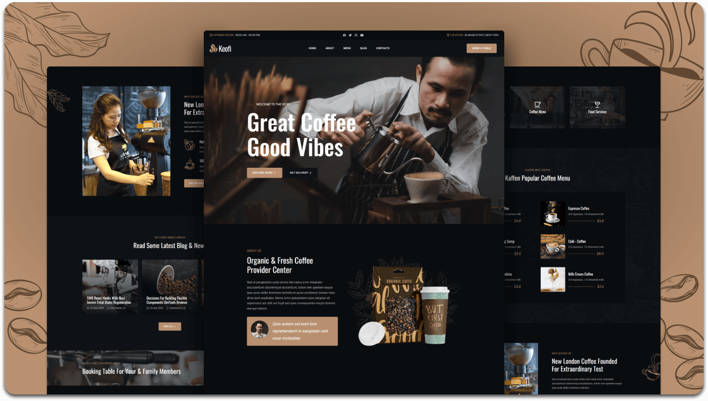

<div align="center">
  
  
  
  # ☕ Keofi - Coffee Shop Website Template
  
  [](https://coffeeshop-template-aditya8raj.vercel.app/)
  
  
  
  
  **A warm and inviting website template for coffee shops and cafés**
  
  [🌐 Live Demo](https://coffeeshop-template-aditya8raj.vercel.app/) • [📝 Documentation](#features) • [🚀 Get Started](#quick-start)
  
</div>

---

## 📋 Overview

**Keofi** is a beautifully designed coffee shop website template perfect for cafés, coffee houses, and beverage businesses. Built with HTML5, CSS3, and vanilla JavaScript, this template features a warm, inviting design with smooth reveal animations and a comprehensive menu showcase.

### ✨ Key Features

- ☕ **Coffee Shop Focused** - Perfect for cafés and coffee houses
- 📱 **Fully Responsive** - Seamless experience on all devices
- 🎨 **Warm Design** - Inviting, cozy interface
- 🎭 **Reveal Animations** - Smooth scroll-based animations
- ⚡ **Optimized** - Fast loading and performance
- 🔧 **Easy to Customize** - Clean, organized code

---

## 🛠️ Tech Stack

| Technology   | Purpose                                         |
| ------------ | ----------------------------------------------- |
| HTML5        | Semantic structure and markup                   |
| CSS3         | Modern styling and animations                   |
| JavaScript   | Interactive functionality and reveal animations |
| Ionicons     | Icon library                                    |
| Google Fonts | Typography (Merienda, Oswald, Roboto)           |

---

## 📁 Project Structure

```
coffeeShop/
│
├── index.html              # Main HTML file
├── favicon.svg             # Site favicon
├── README.md               # Documentation
│
├── assets/
│   ├── css/
│   │   └── style.css       # Main stylesheet
│   │
│   ├── js/
│   │   └── script.js       # JavaScript functionality
│   │
│   └── images/
│       ├── logo.svg
│       ├── hero-banner.jpg
│       ├── about-banner.png
│       ├── about-img.png
│       ├── service-1.jpg
│       ├── service-2.jpg
│       ├── service-3.jpg
│       ├── menu-bg.jpg
│       ├── menu-bg-logo.png
│       ├── menu-1.jpg to menu-6.jpg
│       ├── feature-banner.jpg
│       ├── feature-icon-1.png
│       ├── feature-icon-2.png
│       ├── feature-abs-1.png to feature-abs-3.png
│       ├── blog-1.jpg to blog-3.jpg
│       ├── cta-bg.jpg
│       └── gallery-1.jpg to gallery-5.jpg
│
└── readme-images/
    └── hero.png            # README preview image
```

---

## 📄 License

This project is licensed under the **MIT License** - see the [LICENSE](LICENSE) file for details.

---

## 👨‍💻 Author

**ADITYA RAJ**

- Website: [adityaraj.codes](https://adityaraj.codes)
- GitHub: [@Aditya8Raj](https://github.com/aditya8raj)

---

<div align="center">
  
  ### ⭐ Star this repo if you find it useful!
  
  Made with ❤️ by [ADITYA RAJ](https://adityaraj.codes)
  
  **[⬆ Back to Top](#-keofi---coffee-shop-website-template)**
  
</div>
