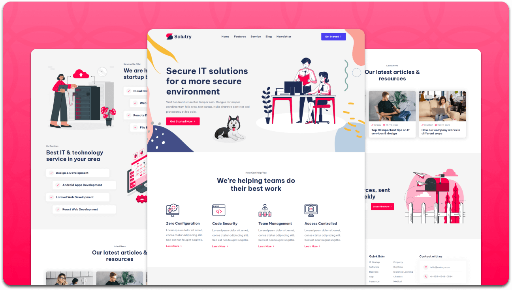

<div align="center">
  
  
  
  # 💼 Solutry - IT Agency Website Template
  
  [](https://itagency-template-aditya8raj.vercel.app/)
  
  
  
  
  **A modern, professional website template for IT agencies and tech startups**
  
  [🌐 Live Demo](https://itagency-template-aditya8raj.vercel.app/) • [📝 Documentation](#features) • [🚀 Get Started](#quick-start)
  
</div>

<br />

---

## 📋 Overview

**Solutry** is a clean and modern IT agency website template designed for technology companies, software agencies, and IT startups. Built with HTML5, CSS3, and vanilla JavaScript, this template features a professional layout with smooth animations and modern design elements.

### ✨ Key Features

- 💻 **IT & Tech Focused** - Perfect for IT agencies and startups
- 📱 **Fully Responsive** - Seamless experience on all devices
- 🎨 **Modern Design** - Clean, professional interface
- ⚡ **Lightweight** - Fast loading and optimized
- 🎭 **Smooth Animations** - Engaging user experience
- 🔧 **Easy to Customize** - Well-structured code

---

## 🛠️ Tech Stack

| Technology   | Purpose                       |
| ------------ | ----------------------------- |
| HTML5        | Semantic structure and markup |
| CSS3         | Modern styling and animations |
| JavaScript   | Interactive functionality     |
| Ionicons     | Icon library                  |
| Google Fonts | Typography (Be Vietnam Pro)   |

---

## 📁 Project Structure

```
itAgency/
│
├── index.html              # Main HTML file
├── favicon.svg             # Site favicon
├── README.md               # Documentation
│
├── assets/
│   ├── css/
│   │   └── style.css       # Main stylesheet
│   │
│   ├── js/
│   │   └── script.js       # JavaScript functionality
│   │
│   └── images/
│       ├── logo.svg
│       ├── hero-banner.png
│       ├── shape1.png
│       ├── shape2.png
│       ├── shape3.png
│       ├── features-icon-1.png
│       ├── features-icon-2.png
│       ├── features-icon-3.png
│       ├── features-icon-4.png
│       ├── service-1.png
│       ├── service-2.png
│       ├── newsletter.png
│       ├── blog-1.jpg
│       ├── blog-2.jpg
│       └── blog-3.jpg
│
└── readme-images/
    ├── hero.png            # README preview image
    └── project-logo.png
```

---

## 📄 License

This project is licensed under the **MIT License** - see the [LICENSE](LICENSE) file for details.

---

## 👨‍💻 Author

**ADITYA RAJ**

- Website: [adityaraj.codes](https://adityaraj.codes)
- GitHub: [@Aditya8Raj](https://github.com/aditya8raj)

---

<div align="center">
  
  ### ⭐ Star this repo if you find it useful!
  
  Made with ❤️ by [ADITYA RAJ](https://adityaraj.codes)
  
  **[⬆ Back to Top](#-solutry---it-agency-website-template)**
  
</div>
