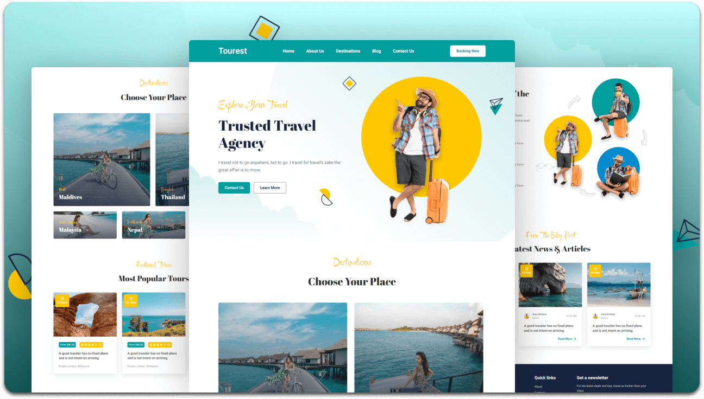

<div align="center">
  
  
  
  # ✈️ Tourest - Travel Agency Website Template
  
  [](https://travelagency-template-aditya8raj.vercel.app/)
  
  
  
  
  **An adventurous and vibrant website template for travel agencies and tour operators**
  
  [🌐 Live Demo](https://travelagency-template-aditya8raj.vercel.app/) • [📝 Documentation](#features) • [🚀 Get Started](#quick-start)
  
</div>

---

## 📋 Overview

**Tourest** is a vibrant and modern travel agency website template designed for tour operators, travel agencies, and destination marketers. Built with HTML5, CSS3, and vanilla JavaScript, this template features an adventurous design with beautiful destination showcases and tour packages.

### ✨ Key Features

- ✈️ **Travel Focused** - Perfect for travel agencies and tour operators
- 📱 **Fully Responsive** - Seamless experience on all devices
- 🎨 **Vibrant Design** - Eye-catching, adventurous interface
- 🌍 **Destination Showcase** - Beautiful destination cards
- ⚡ **Optimized** - Fast loading and performance
- 🔧 **Easy to Customize** - Clean, organized code

---

## 🛠️ Tech Stack

| Technology   | Purpose                                            |
| ------------ | -------------------------------------------------- |
| HTML5        | Semantic structure and markup                      |
| CSS3         | Modern styling and animations                      |
| JavaScript   | Interactive functionality                          |
| Ionicons     | Icon library                                       |
| Google Fonts | Typography (Abril Fatface, Comforter Brush, Heebo) |

---

## 📁 Project Structure

```
travelAgency/
│
├── index.html              # Main HTML file
├── favicon.svg             # Site favicon
├── README.md               # Documentation
│
├── assets/
│   ├── css/
│   │   └── style.css       # Main stylesheet
│   │
│   ├── js/
│   │   └── script.js       # JavaScript functionality
│   │
│   └── images/
│       ├── hero-banner.png
│       ├── hero-bg-top.png
│       ├── hero-bg-bottom.png
│       ├── shape-1.png
│       ├── shape-2.png
│       ├── shape-3.png
│       ├── destination-1.jpg to destination-5.jpg
│       ├── popular-1.jpg to popular-3.jpg
│       ├── about-banner.png
│       ├── blog-2.jpg
│       ├── blog-3.jpg
│       ├── author-avatar.png
│       └── footer-bg.png
│
└── readme-images/
    └── hero.png            # README preview image
```

---

## 📄 License

This project is licensed under the **MIT License** - see the [LICENSE](LICENSE) file for details.

---

## 👨‍💻 Author

**ADITYA RAJ**

- Website: [adityaraj.codes](https://adityaraj.codes)
- GitHub: [@Aditya8Raj](https://github.com/Aditya8Raj)

---

<div align="center">
  
  ### ⭐ Star this repo if you find it useful!
  
  Made with ❤️ by [ADITYA RAJ](https://adityaraj.codes)
  
  **[⬆ Back to Top](#-tourest---travel-agency-website-template)**
  
</div>
